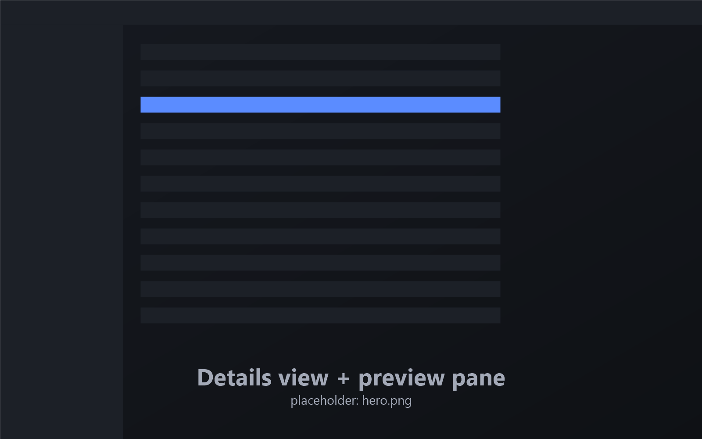
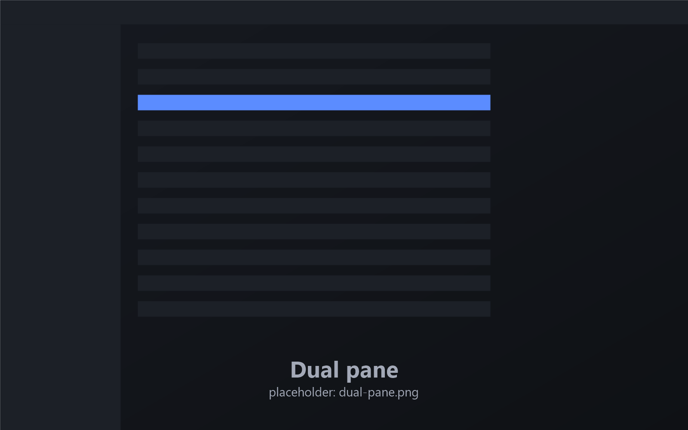
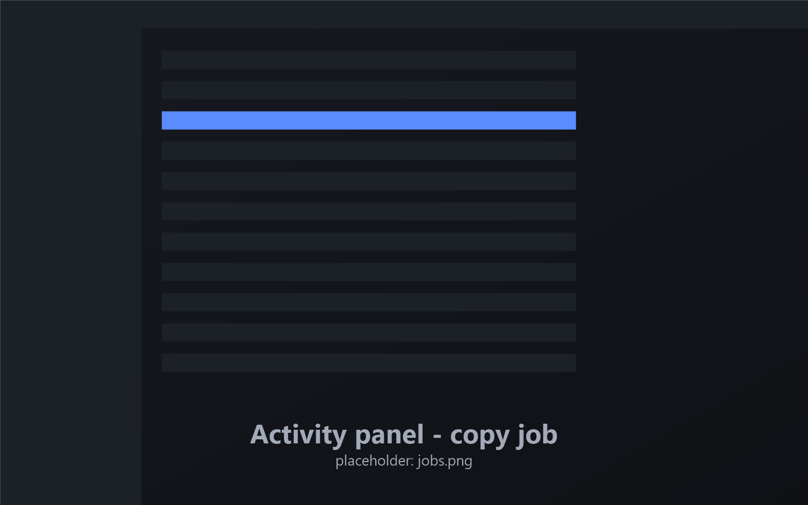
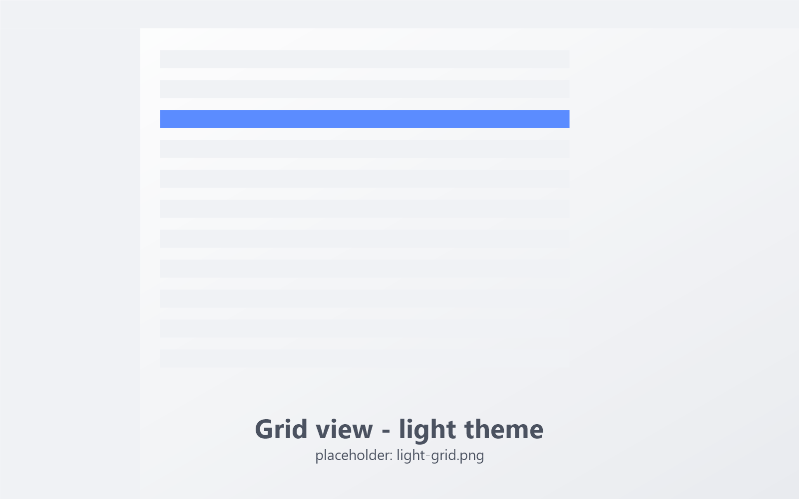

<p align="center">
  
</p>

<h1 align="center">Soyuz</h1>

<p align="center">
  <b>A keyboard-first file explorer.</b><br>
  Written in Rust with <a href="https://github.com/emilk/egui">egui</a>. One TOML file configures everything.
</p>

<p align="center">
  <a href="https://ulaas.github.io/soyuz/">Website</a> ·
  <a href="https://github.com/ulaas/soyuz/releases/latest">Download</a> ·
  <a href="docs/USER_GUIDE.md">User guide</a> ·
  <a href="docs/KEYBOARD.md">Keyboard</a> ·
  <a href="docs/CONFIG.md">Config reference</a> ·
  <a href="#building">Build</a>
</p>

---

Soyuz is a file manager built around one promise: the window never stops responding. Every
copy, move, delete, extract or checksum runs as a background **job** with real progress,
pause / resume / cancel, conflict handling, history and undo. Listings stream in, folders
with 100 000 entries scroll smoothly, and a dead network share cannot hang the window.

<p align="center">
  
</p>

<p align="center">
  
  
  
</p>

## Principles

- **Keyboard first.** Every action is in the command palette (`Ctrl+K`) and can be bound to
  any key, chord or sequence. Presets for Explorer, Commander, Finder and Vim habits.
- **Never blocks.** All disk, network and archive work happens on worker threads; the UI
  thread only draws, and draws nothing while idle.
- **Every operation is a job.** Queued per device, pausable, cancellable, journaled so it
  can resume after a crash, and undoable.
- **Safe by default.** Destructive actions go to the trash first or can be undone; conflicts
  are always your call.
- **No shell backend.** Soyuz does not use `shell32`, `IFileOperation`, `ShellExecute` or
  any COM shell API. File-system work goes straight to the kernel (`kernel32` / `ntdll` /
  `advapi32` on Windows, `rustix` / `libc` on Unix), so behaviour is predictable,
  cancellable and the same on every machine. CI fails the build if a shell API sneaks in.
- **Fully configurable.** Every behaviour has a setting, in the settings window and in a
  hot-reloaded `config.toml` that keeps your comments.
- **Private.** No telemetry. Update checks only when you ask.

## Features

**Browsing**
- Details, list, grid (thumbnails, folder mosaics), gallery and Miller-column views, remembered per folder
- Tabs with groups, pinning and tear-off into windows; dual and quad (2×2) panes; saved workspaces
- Breadcrumb omnibar with path editing and completion, live filter, type-ahead, navigation history graph, timeline of recent changes
- Sidebar with favorites, drives, a Portal for pinned folders (drop folders on it), tags, network places, cloud folders, smart folders, and a full-height disk tree
- Archives browse like folders: zip, 7z, tar.\*, RAR, ISO / UDF, CAB, deb / rpm (zip can be edited in place)
- Remote locations: SFTP, WebDAV, FTP / FTPS, S3-compatible storage and `\\server` shares

**File operations**
- Background jobs: per-device queueing, priorities, pause / resume / cancel, speed graph and ETA, crash-safe journal
- Conflict dialog with side-by-side comparison, "apply to all", keep both / replace / skip
- Undo / redo for copy, move, rename, trash, new items, archive edits and metadata changes
- Trash, secure wipe, batch rename with live preview, bulk attributes, links and junctions, verified copies
- Drag and drop between panes, tabs, the sidebar and other apps; OS clipboard interop

**Tools**
- Integrated terminal that follows the current folder
- Preview pane and Quick Look (`Space`): code with syntax highlighting, images, Markdown, PDF, Office documents, EPUB, fonts, 3D models, audio waveform and playback, video posters, two-file diff
- Built-in text, hex and image editors
- Search by name and content; a background index (SQLite FTS5 + NTFS change journal) with a query language and live smart folders
- Disk-usage treemap, folder compare and two-way sync with scheduled profiles, previous versions, duplicate finder, split / join, checksums
- Git status column, renameable color tags, folder colors, drop shelf, recent places
- Automation: sandboxed Rhai scripts, watcher-driven rules, and a `soyuz cp|mv|rm …` CLI that queues jobs in the running window

**Optional AI assistant (off by default)**
- Works with Anthropic, OpenAI, Gemini or local OpenAI-compatible models (Ollama, LM Studio, llama.cpp, vLLM); bring your own key
- Every change is a dry-run plan you approve; it then runs as a normal, undoable job. Per-folder permissions, redaction, budgets and an audit log
- An MCP server (`soyuz --mcp`) so other assistants can drive Soyuz under the same approval rules, and an MCP client for external tools
- API keys live in the operating system's credential store, never in `config.toml`

**Make it yours**
- Five color themes with dark and light variants, user theme files, the Windows accent color, Mica / Acrylic backdrops
- English and Turkish UI with locale-aware dates, sizes and sorting; switches live
- Can register itself as the default folder handler for your account (Settings → General), with an exact restore

**Accessibility**
- Screen-reader support through AccessKit — see [docs/ACCESSIBILITY.md](docs/ACCESSIBILITY.md)
- High-contrast theme, reduced motion, touch density with large targets
- Interface zoom (`Ctrl+=` / `Ctrl+-` / `Ctrl+0`), visible focus rings, keyboard access everywhere

## Keyboard shortcuts

A few defaults of the *Explorer* preset. The full list for every preset is in
[docs/KEYBOARD.md](docs/KEYBOARD.md), with a printable [one-page version](docs/keyboard.html).
Every binding can be changed in **Settings → Keyboard**.

| Action | Shortcut | Action | Shortcut |
|---|---|---|---|
| Command palette | `Ctrl+K` / `Ctrl+Shift+P` | Go to folder | `Ctrl+P` |
| Back / Forward / Up | `Alt+←` / `Alt+→` / `Alt+↑` | Edit path | `Ctrl+L` |
| New tab / Close tab | `Ctrl+T` / `Ctrl+W` | Dual pane / Quad | `F9` / `Shift+F9` |
| Copy / Cut / Paste | `Ctrl+C` / `Ctrl+X` / `Ctrl+V` | Copy / move to other pane | `F5` / `F6` |
| Rename / Batch rename | `F2` / `Ctrl+Shift+R` | Move to trash / Delete | `Del` / `Shift+Del` |
| Undo / Redo | `Ctrl+Z` / `Ctrl+Y` | Quick Look | `Space` |
| Terminal | ``Ctrl+` `` | Activity panel | `Ctrl+Shift+J` |
| AI assistant | `Ctrl+I` | Settings | `Ctrl+,` |

## Install

Download from [GitHub Releases](https://github.com/ulaas/soyuz/releases/latest). Every file
has a `.sha256`, and `SHA256SUMS-<os>.txt` lists them all.

| Package | How |
|---|---|
| `soyuz-<version>-windows-x64.msi` | Per-user install to `%LOCALAPPDATA%\Programs\Soyuz`, no admin rights. Optional "Open in Soyuz" folder context-menu entry and PATH entry. |
| `soyuz-<version>-windows-x64.zip` | Unzip anywhere and run `soyuz.exe`. Settings go to `%APPDATA%\soyuz`. |
| `soyuz-<version>-windows-x64-portable.zip` | Same, plus an empty `portable` file next to the exe: settings stay in `portable-data\` beside it. |
| `soyuz-<version>-linux-x64.tar.gz` | Unpack anywhere and run `soyuz`. |
| `soyuz-<version>-macos-arm64.tar.gz` | Apple silicon. Unpack and run `soyuz`; unsigned (right-click → Open the first time). |

**Platforms.** Soyuz is fully supported on **Windows 10 and 11**, **macOS** (Apple silicon)
and **Linux** (x64, Wayland and X11), with native integration on each. Release builds are not
code-signed yet.

PDF page rendering needs `pdfium.dll` next to `soyuz.exe` or in the config folder (Soyuz
never downloads it; without it PDFs preview as text). Video posters use an `ffmpeg` found
on `PATH`.

## Configuration

Everything lives in one file, `config.toml`:

| OS | Location |
|---|---|
| Windows | `%APPDATA%\soyuz\config\config.toml` |
| Linux | `~/.config/soyuz/config.toml` |
| macOS | `~/Library/Application Support/soyuz/config.toml` |
| Portable | `portable-data\config.toml` next to the executable when an empty file named `portable` sits beside it |

Edits made in a text editor apply within a second; a parse error is shown with its line
and column and the previous settings stay active. The settings window writes the file back
with [`toml_edit`](https://docs.rs/toml_edit), so your comments and ordering are preserved.
[docs/CONFIG.md](docs/CONFIG.md) lists every key with its type, default and meaning;
[docs/config.example.toml](docs/config.example.toml) is an annotated sample.

## Building

Requirements: the Rust toolchain pinned in `rust-toolchain.toml` (rustup installs it
automatically).

```sh
cargo run --release -p soyuz-app          # build and start
cargo build --release -p soyuz-app        # binary: target/release/soyuz(.exe)
cargo test --workspace                    # all tests
cargo clippy --workspace --all-targets -- -D warnings
```

**Windows** — MSVC toolchain. The Windows SDK resource compiler (`rc.exe`) embeds the app
icon; without it the build still succeeds. Packaging:

```powershell
./scripts/package.ps1                     # dist/soyuz-<version>-windows-x64.zip
./scripts/package.ps1 -Portable           # ...-portable.zip
./scripts/package.ps1 -Msi                # + .msi (needs WiX v5: dotnet tool install --global wix --version 5.0.2)
./installer/msix/build-msix.ps1           # unsigned MSIX via makeappx
```

**Linux** — install the windowing, audio and font headers first:

```sh
sudo apt-get install pkg-config libasound2-dev libxkbcommon-dev libwayland-dev libx11-dev \
  libxcursor-dev libxrandr-dev libxi-dev libgl1-mesa-dev libfontconfig1-dev
```

**macOS** — Xcode command-line tools.

## Architecture

A Cargo workspace of twelve crates with an acyclic dependency graph. Only `soyuz-term` and
`soyuz-app` depend on egui; everything else is plain Rust and unit-tested in isolation.

| Crate | Role |
|---|---|
| [`soyuz-core`](crates/soyuz-core) | Shared vocabulary: entries, locations, errors, sorting, filtering, locale formatting, cancellation, the config schema, actions and key maps. |
| [`soyuz-fs`](crates/soyuz-fs) | Platform layer over raw OS calls: streaming listings, copy with progress / reflink / sparse, move, delete, trash, links, attributes, ACLs, volumes, watching, launching, shadow copies, USN journal. |
| [`soyuz-jobs`](crates/soyuz-jobs) | The operation engine: queue and scheduler, planning, conflict / error prompts, progress snapshots, crash journal, history, undo / redo. |
| [`soyuz-archive`](crates/soyuz-archive) | Archive readers and writers with an indexed virtual file system. |
| [`soyuz-search`](crates/soyuz-search) | Parallel name / content search, folder sizes, size trees, duplicate detection, folder compare. |
| [`soyuz-index`](crates/soyuz-index) | Background index (SQLite + FTS5), query language, smart-folder queries. |
| [`soyuz-vfs`](crates/soyuz-vfs) | Remote providers (SFTP, WebDAV, FTP / FTPS, S3) and resumable cross-provider transfers. |
| [`soyuz-term`](crates/soyuz-term) | Embedded terminal widget (alacritty_terminal + ConPTY / PTY). |
| [`soyuz-ai`](crates/soyuz-ai) | AI providers, credential store, tool catalog with risk classes and dry-run plans, audit log. |
| [`soyuz-mcp`](crates/soyuz-mcp) | MCP server (stdio, named-pipe attach, localhost HTTP) with a client trust model, and an MCP client. |
| [`soyuz-script`](crates/soyuz-script) | Sandboxed Rhai scripting for actions, menus, columns, previewers and automation rules. |
| [`soyuz-app`](crates/soyuz-app) | The `soyuz` binary: egui shell, views, dialogs, palette, settings, services and the design system. |

Widgets never mutate state directly: they push commands, one dispatcher applies them, and
the same action system backs key bindings, menus, toolbar buttons and the palette.

## Built with AI, with a hint of human taste

Soyuz was developed fully with AI. Models wrote the code, the tests and the documentation;
a human decided what to build, tried every change in the real app, and kept what felt right.

## Security

Please report vulnerabilities privately — see [.github/SECURITY.md](.github/SECURITY.md).

## License

[MIT](LICENSE). Bundled fonts (Inter, IBM Plex Sans / Mono, Noto Sans, Cascadia Mono,
JetBrains Mono, Source Code Pro) are under the SIL Open Font License 1.1, Phosphor icons
under MIT; every third-party component and its licence is listed in
[THIRD-PARTY-NOTICES.md](THIRD-PARTY-NOTICES.md).
