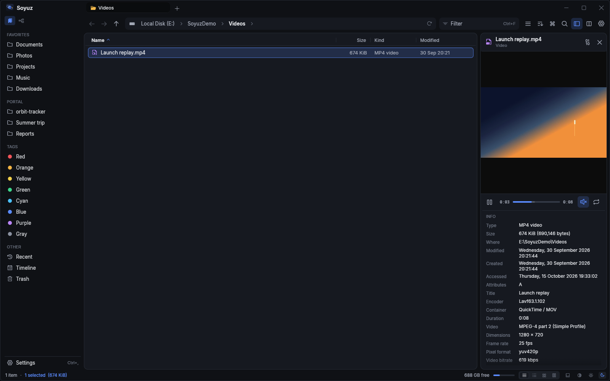
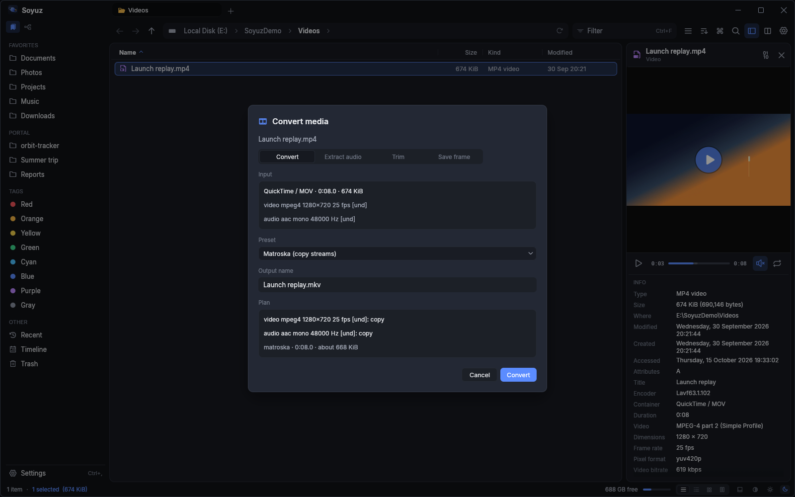
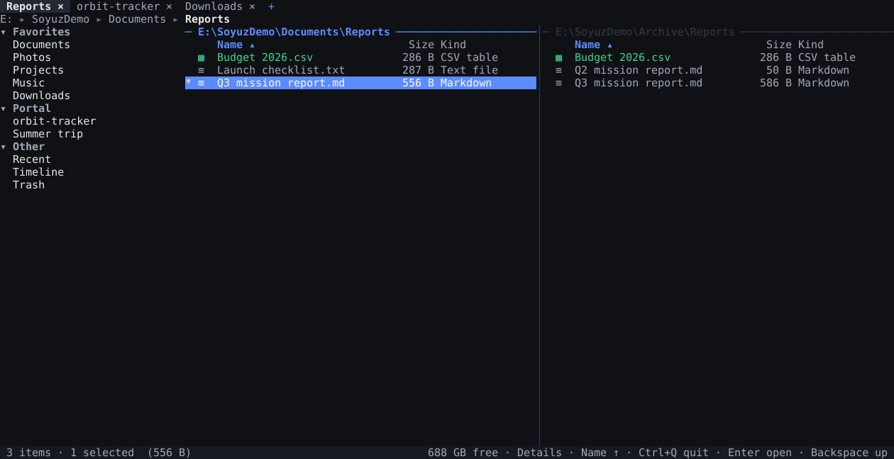
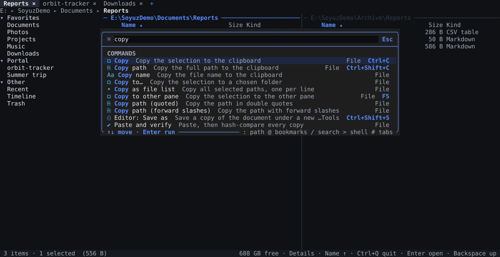
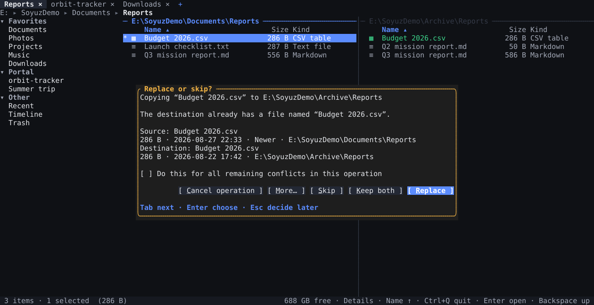
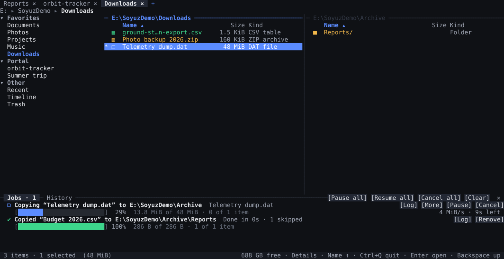
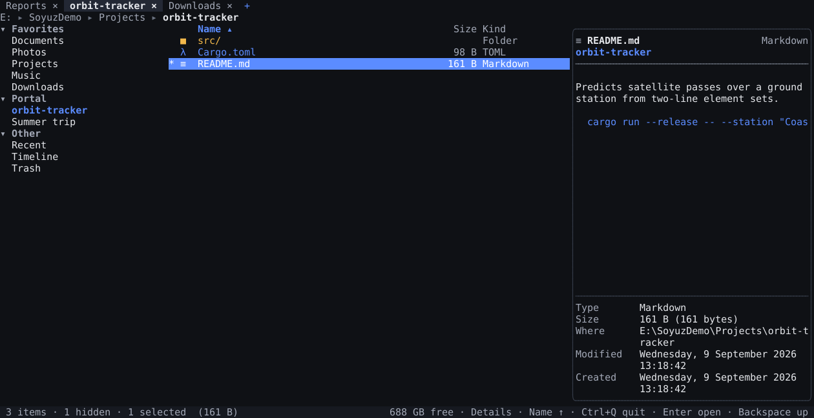
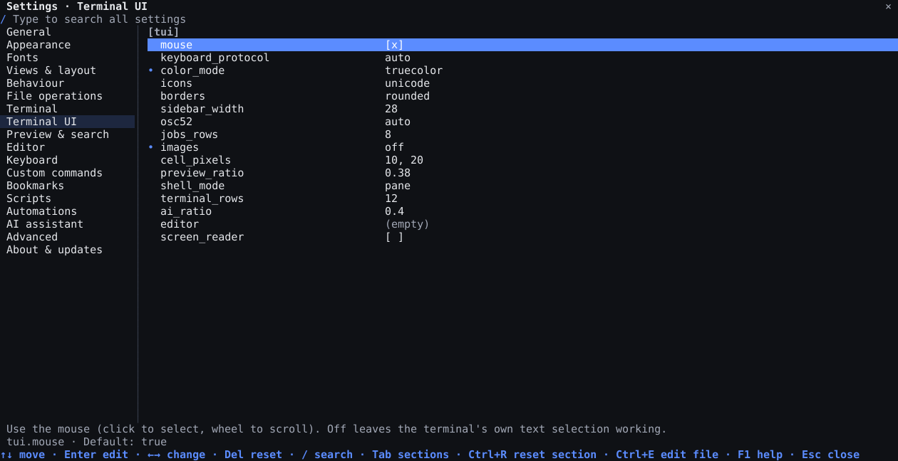
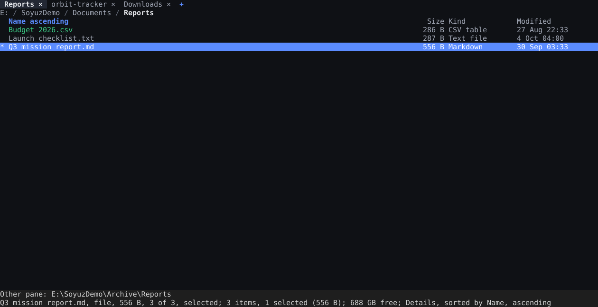

# Soyuz user guide

A practical tour of Soyuz: how the window is laid out, how to move around quickly, how
file operations behave, and where every setting lives. Shortcuts below are the defaults
of the *Explorer* preset; the command palette always shows the active ones.

- [The window](#the-window)
- [Moving around](#moving-around)
- [Selecting and acting on files](#selecting-and-acting-on-files)
- [Background jobs, conflicts and undo](#background-jobs-conflicts-and-undo)
- [Panels: preview, terminal, activity, shelf](#panels-preview-terminal-activity-shelf)
- [Media](#media)
- [Tools](#tools)
- [Search](#search)
- [Customizing](#customizing)
- [Terminal UI](#terminal-ui)
- [Accessibility](#accessibility)
- [Installing, updates and the default file manager](#installing-updates-and-the-default-file-manager)
- [Portable mode and data files](#portable-mode-and-data-files)
- [Troubleshooting](#troubleshooting)

## The window

```
┌ sidebar ─┬ tabs ────────────────────────────────────────────────┐
│ [▤] [⑃]  │ ← → ↑  Home › Projects › soyuz        Filter   ⌘ ▤ ◫ │  toolbar + omnibar
│ Favorites├──────────────────────────────────────────────────────┤
│ Devices  │  file list (details / list / grid / gallery / Miller) │  preview pane →
│ Portal   │                                                      │
│ Tags     │                                                      │
│ Other    ├──────────────────────────────────────────────────────┤
│ Network  │  terminal · activity (toggle with Ctrl+` / Ctrl+⇧J)  │
│ Cloud    │                                                      │
└──────────┴──────────────────────────────────────── status bar ──┘
```

- **Tabs** (`Ctrl+T`, `Ctrl+W`, `Ctrl+Shift+T` reopens) can be pinned, dragged and opened
  from the middle mouse button. A tab can hold **two panes** (`F9`) side by side or stacked;
  `Tab` switches between them and the splitter is draggable (double-click resets it).
- The **omnibar** shows the path as clickable segments; the small chevrons open sibling
  folders. Click the empty area or press `Ctrl+L` to type a path (with completion).
- The **status bar** shows counts, selection size, free space, an icon-size slider, view
  and theme switches, and a ring when jobs are running.
- **Focus mode** (`Ctrl+Shift+B`, or *Focus mode* in the palette) hides the sidebar, the
  panels, the status bar and the tab strip, leaving the toolbar and the listing; press it
  again to bring back what was shown. *Settings → Views → Focus mode hides* picks the parts
  (`[layout] focus_mode_hides`).

### The sidebar

A small icon bar at the top of the sidebar switches between two views (`Ctrl+Shift+E`
toggles too):

- **Places**: collapsible sections, from top to bottom **Favorites**, **Devices**,
  **Portal**, **Tags**, **Other** (Recent, Timeline, Trash), **Network**, **Cloud** and
  Smart folders. Choose and reorder them in *Settings → Views → Sidebar sections*.
- **Disk tree**: your drives and home folder as one folder tree that fills the whole
  sidebar (with a filter box on top). *Settings → Views → Sidebar content → Both* shows the
  tree as a section below the places instead.

Below the favorites, after a **System** divider, sit system folders: AppData (Roaming and
Local), ProgramData and Temp on Windows; `~/.config`, `~/.local/share`, `~/.cache` and
`/tmp` on Linux. Hover the divider and click its eye button (or right-click one of them →
*Hide system folders…*) to hide them; Soyuz asks first and tells you where to bring them
back. *Settings → Views → System folders* turns them on again and picks which ones show,
with more to choose from (Program Files, Start menu, Startup, Fonts, `drivers\etc`, Soyuz's
own settings folder; `/etc`, `/opt`, `/var/log`, `~/.local/bin`, Flatpak app data, …).

**Portal** is a drop zone for the folders you are working with: drag one or more folders
onto the Portal section (from the file list, the disk tree, the shelf, or from Explorer)
and they are pinned there. Dropping only pins (nothing is copied or moved); files,
duplicates and folders that no longer exist are skipped. Click a pin to open it,
middle-click to open it in a new tab, drag pins to reorder them, and right-click for open
in a new tab / other pane, reveal, copy path, **Rename label…** and **Unpin**. A pin whose
folder is gone is dimmed and marked *missing* until you unpin it or the folder returns.
Pins are kept in `config.toml` (`[[sidebar.portal]]`) and can also be edited in
*Settings → Views → Portal*.

## Moving around

| | |
|---|---|
| `Enter` / double-click | open a folder or a file (default app) |
| `Backspace`, `Alt+↑` | parent folder |
| `Alt+←` / `Alt+→`, mouse back / forward | history (right-click the arrows for the list) |
| `Ctrl+P` | **Go to folder**: fuzzy jump to any folder you visited, ranked by frecency |
| `Ctrl+K` | **Command palette**: every action; prefixes `:` path, `@` bookmark, `/` search, `>` shell, `#` tab |
| typing letters | type-ahead jumps to the first matching name (or filters, see *Behaviour*) |
| `Ctrl+F` | live filter of the current folder |
| `Alt+1…9` | bookmarks |

Views: `Ctrl+Shift+1…5` for details, grid, list, Miller columns and gallery. Each folder
remembers its view, sort and columns; *View → Apply to all folders* makes it the default.
`Ctrl+Alt+=` / `Ctrl+Alt+-` (or `Ctrl`+wheel) change icon size in grid and gallery.

## Selecting and acting on files

Click, `Shift`+click and `Ctrl`+click select; drag on empty space for a rubber band;
`Ctrl+A`, `Ctrl+Shift+I` (invert) and *Select by pattern* (palette) cover the rest. Checkbox
mode (status bar or palette) adds tick boxes for mouse and touch users.

| | |
|---|---|
| `Ctrl+C` / `Ctrl+X` / `Ctrl+V` | copy / cut / paste — works with other apps' file clipboard too |
| `F5` / `F6` | copy / move to the other pane |
| `F2` | rename in place (`Ctrl+Shift+R` batch rename with live preview, regex and counters) |
| `Del` / `Shift+Del` | trash / delete permanently (confirmations are configurable) |
| `Ctrl+Shift+N` / `Ctrl+Alt+N` | new folder / new file |
| `Alt+Enter` | properties: attributes, times, permissions, checksums, details |
| `Space` | Quick Look; arrows move to the next item while it is open |
| `Enter` / `Shift+Enter` | open with the default app / choose the app (*Open with…*) |

**Pasting a picture.** With a picture on the clipboard (a screenshot, or an image copied
in a browser or an editor), `Ctrl+V` in a folder saves it there as a PNG file named
*Pasted image 2026-10-16 143012.png* and selects the name so you can type a better one.
It is an ordinary job: `Ctrl+Z` removes the file again. Copied files are pasted first.
Turn it off in *Settings → Behaviour → Paste pictures as files*
(`[behaviour] paste_images`).

`Ctrl+Alt+V` (*Clipboard history* in the palette) lists the file sets you copied or cut
earlier this session, newest first; Enter copies the picked set again, ready for `Ctrl+V`
(a cut set comes back as a copy). It keeps the last 10 sets
(`[behaviour] clipboard_history`, 0 turns it off).

Drag and drop works between panes, tabs, the sidebar, the shelf and other applications.
The default drop effect follows the platform convention (move on the same drive, copy
across drives); hold `Ctrl` to copy, `Shift` to move, or set *Behaviour → Drag and drop*
to *Ask*. While dragging, rest on a folder, a breadcrumb segment, a sidebar place or
another tab for a moment and it opens (spring-loaded folders; delay and on/off in
*Behaviour → Drag and drop*).

### Default apps

`Enter` opens a file with its default app. Unless you set one in Soyuz, that is the
system's default. `Shift+Enter` (or *Open with…* in the context menu) lists the apps
registered for the file type: ↑ / ↓ choose, `Enter` opens, and `Tab` reaches the program
field and the **Always use this app for .ext files** checkbox (`Space` ticks it). With
the box ticked, the choice becomes the default for that extension in Soyuz: `Enter`,
double-click, files opened from archives and remote folders, and `soyuz open` all use it,
in the window and in the terminal UI. Untick it to go back to the system's default.

*Open with…* starts on the extension's default app, or on the app you chose last time
for that extension (`[open] remember_choice`). *Settings → Behaviour → Opening files
with* lists the defaults: edit their extensions (`mp4 mkv`), name or program, or remove
them. They are kept in `[[open.default_apps]]` in `config.toml`. Soyuz doesn't change
the system's own default apps. Apps that open through the system, such as Store apps,
can't be a Soyuz default.

**Unrecognized files.** A file no app is registered for, an unknown type or a file
without an extension, opens *Open with…* on `Enter` instead of an error
(`[open] choose_when_unknown`, *Settings → Behaviour → Ask for unrecognized files*). The
list is then usually empty: type or paste the program's full path, tick **Always use this
app**, and that type opens with it from then on. Files without an extension (`README`,
`Makefile`, `.bashrc`) share one default, shown as **Always use this app for files without
an extension** and kept as the extension `.` in `[[open.default_apps]]`.

## Background jobs, conflicts and undo

Every operation runs as a job; the window stays responsive. Small jobs finish quietly
with a toast (with **Undo**); longer ones open the **activity panel** (`Ctrl+Shift+J`)
automatically. Each job card shows progress, speed graph and ETA, and can be paused,
resumed, cancelled, reprioritized or started immediately.

When a destination already exists, the **conflict dialog** compares both files (size,
date, which is newer / larger) and offers *Replace*, *Keep both*, *Skip* and more, with
*Do this for all remaining conflicts*. Errors offer *Retry*, *Skip* and *Skip all*.

`Ctrl+Z` / `Ctrl+Y` undo and redo copies, moves, renames, trashing, new items and
attribute changes. *History* in the activity panel lists past operations with undo, redo
and *Retry failed*.

## Panels: preview, terminal, activity, shelf

- **Preview** (`Alt+P`): syntax-highlighted text, markdown, images, hex for binaries, plus
  file info. *Toggle hex preview* (palette) switches to the hex view.
  Richer previews (each can be switched off in *Settings → Preview & search*, `[preview]`):
  - **PDF**: pages render with pdfium (`PgUp` / `PgDn` flip pages in Quick Look; a *Text*
    tab shows the extracted text). Soyuz does not bundle or download pdfium: get a prebuilt
    `pdfium.dll` (for example from the *bblanchon/pdfium-binaries* GitHub releases, the
    `pdfium-win-x64` archive's `bin/pdfium.dll`) and put it next to `soyuz.exe`, in the
    config folder, or in the folder named by `[preview] pdfium_dir`. No restart is needed.
    With pdfium present the grid and gallery views also show the first page as the PDF's
    thumbnail (`[appearance] pdf_thumbnails`).
    Without it, PDFs show their page count, document info and text (pure-Rust fallback).
    An encrypted PDF shows a lock card: *Enter password…* there, or *PDF password…* in the
    item menu or the palette (terminal UI too), opens it. The password is kept until Soyuz
    closes, never written to disk.
  - **Folders**: counts, sizes and the most common types; a folder with a README or notes
    file (`[preview] folder_notes_files`) shows it below, Markdown rendered, with *Edit* to
    change it in the built-in editor.
  - **Office / OpenDocument**: docx / odt text with headings, bold, italic and lists;
    xlsx / ods first sheet as a table (`sheet_rows`); pptx / odp slide titles and bullets.
  - **EPUB**: cover, title, authors, description and the table of contents.
  - **Fonts** (ttf, otf, ttc, woff, woff2): a specimen, the character set and a glyph grid.
  - **3D models** (glTF / GLB, STL, OBJ): a shaded quick render; drag to rotate, scroll to
    zoom in Quick Look, double-click to reset. Models spin slowly unless reduced motion or
    `model_turntable = false`.
  - **Audio and video**: waveform and tags for audio; streams, chapters and a poster frame
    for video; and a built-in player in the pane and in Quick Look. For the FFmpeg
    libraries, the player, the media tools and their settings, see [Media](#media).
  - **Diff**: select exactly two text files and the preview compares them (older on the
    left; swap, unified or side by side).
- **Terminal** (``Ctrl+` ``): your shell in the current folder. It follows navigation (and,
  optionally, navigates the pane when you `cd`). `Esc` on an empty line returns to the
  file list; `Ctrl`+click opens links and paths.
- **Shelf** (palette: *Toggle shelf*): drop files from anywhere, keep browsing, then drag
  them out or copy / move them all at once. Its contents survive restarts.
- **Editor** (`F4`, right-click → *Edit in Soyuz*, palette *Toggle editor panel*): files
  open as tabs in a panel docked right or bottom (or maximized over the panes).
  - *Text*: syntax highlighting, line numbers, find / replace (`Ctrl+F` / `Ctrl+H`; case,
    whole word, regex with `$1`), go to line (`Ctrl+G`), undo / redo, `Ctrl+S`. The
    encoding (UTF-8, UTF-8 BOM, UTF-16) and line endings are kept; click *LF/CRLF* in the
    status line to switch. Files over `[editor] max_text_mib` open read-only in hex.
  - *Hex*: any size, overwrite in the hex or text column (`Tab` switches), data
    inspector, go to offset, find hex bytes or text.
  - *Image*: zoom (wheel, `+`/`-`/`0`/`1`), rotate (`R`), flip (`H`/`V`), crop (`C`, drag,
    `Enter`). PNG/BMP/TIFF/WebP/GIF save losslessly; JPEG is re-encoded.
  - Saving puts the previous version in the trash as `<name>.bak` (`[editor]
    backup_to_trash`). Files changed on disk reload by themselves, or ask when you have
    unsaved changes. Closing a modified tab or the window asks first.

## Media

Soyuz previews, plays and converts video and audio with the **FFmpeg libraries**
(`avcodec`, `avformat`, `avutil`, `swscale`, `swresample`), which it loads at run time.
It never starts an `ffmpeg` program. The settings are under *Settings → Preview & search →
Media* (`[media]`, see [CONFIG.md](CONFIG.md#media)).



### The FFmpeg libraries

- **Bundled.** The installers, zips and tarballs ship an LGPL build of FFmpeg 9.0 next to
  the program (in `lib/soyuz/` in the Linux tarball). On Linux the distribution's
  FFmpeg 8.x or 7.1 libraries also work, and the Flatpak uses the FFmpeg from its runtime.
  You don't have to install anything.
- **Where Soyuz looks**, in this order: the folder in `SOYUZ_FFMPEG_DIR` (for tests),
  `[media] ffmpeg_dir`, the program's folder, the config folder's `ffmpeg/` sub-folder,
  then the system's library folders.
- **The status card** at the top of the Media page shows one of two states:
  - *Loaded*, with the FFmpeg version, the folder, and the number of decoders and
    encoders.
  - *Not loaded*, with the reason and every folder that was searched. *Try again* looks
    again, for example after you have copied the files in.

  A GPL build still loads, but the card flags it, because Soyuz can't be redistributed
  with a GPL build.
- **Download FFmpeg runtime.** When the libraries don't load, the card offers this button.
  The command palette has the same command.
  - It downloads the libraries for your system from the `ffmpeg-runtime-<version>` release
    of the update repository (`[updates] repo`, Settings → About & updates). Without a
    repository, Soyuz doesn't go online.
  - The download is checked against the release's SHA-256 list. Only the five libraries
    and their licence files are unpacked, into `<config dir>/ffmpeg/`.
  - The libraries load straight away, with no restart. A progress bar and *Cancel* are
    shown while the download runs.
  - Flatpak and MSIX packages don't offer it, because they bring their own libraries.
- **Using your own build.** Any FFmpeg 9.0 shared build works (on Linux, 8.x and 7.1 too).
  There are two ways to use one:
  - Click *Choose…* and pick its `avcodec` file. Its folder becomes `[media] ffmpeg_dir`.
  - Put the five libraries into `<config dir>/ffmpeg/`.

  This is how you swap in another LGPL build, or a build with more codecs for your own use.
  A new folder takes effect at the next load. Libraries that are already loaded stay
  loaded until Soyuz restarts.
- **Turning them off.** With `[media] ffmpeg = false`, videos show their container
  metadata only, audio plays through the built-in Symphonia decoder, and the player and the
  media tools are turned off.
- **Other settings on the same page:** *Decoder threads* (`[media] threads`, 0 = one per
  core), and the decode size (`[media] max_px`, the longest edge of frames decoded for
  previews).

### Previews and thumbnails

- **Video** (`[preview] video`): the preview pane and Quick Look list the streams (codec
  and profile, size, frame rate, pixel format, HDR, rotation, audio codec / channels /
  rate, bitrates), chapters and tags. They also show a poster frame taken at
  `[media] poster_secs` (0 = a tenth of the length, at most 5 s). The grid and gallery
  views use a frame from the same point as the thumbnail. `Enter` opens the file in your
  default player.
- **Audio**: waveform, tags, cover art, duration and bitrate, with play / pause and seek
  (click the waveform). `[media] audio_backend` picks the decoder:
  - `auto` uses FFmpeg when it is loaded. FFmpeg plays Opus, WMA, APE, AC-3, DSD, Matroska
    audio and everything else FFmpeg reads.
  - Without FFmpeg, `auto` uses the built-in Symphonia decoder (mp3, flac, wav, ogg, aac,
    alac).
  - `ffmpeg` and `symphonia` force one decoder.

  The facts list names the decoder in use.
- Without the libraries, a video shows its metadata and a card that says where to get the
  libraries.

### The video player

`[media] player` (on by default) plays videos in the preview pane and in Quick Look.

- **In the window**: the poster shows first, with a play button. Click the button or the
  picture, or press `K`, and the video plays in place, scaled to the view. The bar under
  the picture has these controls:
  - play / pause
  - a scrubber: hovering shows the time under the pointer, and the lighter part is what is
    buffered ahead
  - elapsed and total time
  - volume, mute and a loop toggle
- **In the terminal UI** (`soyuz --tui`): the preview pane and Quick Look play videos too.
  - Frames are drawn as terminal images (kitty, sixel, iTerm2 or half blocks) at
    `[media] tui_fps` frames per second (8 by default). They are decoded no bigger than the
    cells show.
  - The status line under the picture shows play / pause, elapsed / total time, a text
    progress bar, the volume, and `muted` / `loop`. Click the mark to play or pause, and
    click the bar to seek.
  - With `[tui] images = "off"`, a line of text replaces the picture and the sound still
    plays.
  - Screen-reader mode reads the status line as words ("Paused, 0:04 of 0:08, volume
    80 %, muted").
- **Keys** work while the player has the keyboard. In the window, that is Quick Look on a
  video or audio file, or the pane's player after you click it or tab to it. In the
  terminal UI, it is Quick Look or the focused preview pane while a player is open. The
  keys are the *Player* context in Settings → Keys ([KEYBOARD.md](KEYBOARD.md)):

  | Key | Does |
  |---|---|
  | `P` / `K` | play / pause |
  | `J` / `←` | back by `[media] seek_step_secs` (5 s) |
  | `L` / `→` | forward by the same step |
  | `-` / `=` | volume down / up |
  | `M` | mute / unmute |

- **Player settings:**
  - `[media] autoplay` starts playing as soon as a video is previewed.
  - `[media] quicklook_space_plays` (Settings → Media, *Space plays in Quick Look*): Space
    plays and pauses a video or audio file in Quick Look, and Esc closes it. Off (the
    default), Space closes Quick Look as it does on any file; `P` / `K` play either way.
    The Quick Look footer shows the play key.
  - `[media] loop` sets the loop toggle's starting state.
  - `[media] volume` and `muted` are saved when you change them in the player. They apply
    to audio previews too.
- **When playback stops:** when the preview moves to another file, when the pane closes,
  and when Quick Look closes.
- Decoding runs on worker threads at the view's size, so the file list stays responsive.
  If the libraries can't open a file, the reason shows in place of the picture.
  `[media] player = false` keeps the poster only.

### Hardware decoding and GPU colour conversion

- **Hardware decoding** (`[media] hw_decode`, default `auto`): the player decodes video on
  the GPU when the codec allows it. It uses Direct3D 11 (D3D11VA) on Windows, VAAPI on
  Linux and VideoToolbox on macOS.
  - `off` decodes in software only. Naming the API forces it.
  - Any failure, at the start or in the middle of a file, falls back to software decoding
    without stopping playback.
  - Thumbnails and posters always decode in software.
- **GPU colour conversion** (`[media] gpu_yuv`, off by default): frames go to the GPU as
  decoded (YUV). A shader converts them with the stream's own colour matrix
  (BT.601 / 709 / 2020) and range, scales them, and tone-maps HDR (PQ / HLG) to SDR. It
  needs the GPU renderer (the default, wgpu). With the OpenGL renderer, or with the
  setting off, frames are converted to RGB on the CPU.
- **When to change them:** turn hardware decoding off if a driver shows wrong colours or
  corrupt frames. Turn GPU colour conversion on for HDR videos, or for large pictures on a
  slow CPU.

### Media tools

There are four media tools: *Convert media…*, *Extract audio…*, *Trim media…* and *Save
video frame…*. Find them in the context menu of a video or audio file, or in the command
palette (`[media] tools`, on by default). All four open one dialog, with a switcher
between the tools. The terminal UI has the same dialog.



- **Convert** uses built-in presets:
  - Matroska or MP4 with the streams copied (no re-encoding, fast)
  - MP4 with H.264 or HEVC on the machine's hardware encoder, shown only when there is one
  - WebM with VP9 or VP8 and Opus
  - ProRes and MPEG-4
  - audio as FLAC, AAC, Opus, WAV or ALAC

  Only the presets this FFmpeg build can encode are listed.
- **Extract audio** keeps the audio track as it is, or re-encodes it (FLAC, AAC, Opus,
  WAV).
- **Trim** takes a start and an end, in seconds (`12.5`) or `m:ss` (`1:05.5`). *Cut on
  keyframes* is fast and doesn't re-encode. With it unticked, the cut is frame-exact.
- **Save frame** saves the frame at a given time as a PNG or JPEG.

**Before anything runs**, the dialog reads the file (off the UI thread) and shows a plan:
- what happens to every stream: copied, encoded (and with which encoder), or dropped (and
  why)
- the estimated size

The output goes beside the source, with the source's name and the new extension. If that
name is taken, the dialog offers *Ask*, *Keep both*, *Replace* or *Skip*. `Enter` runs the
tool and `Esc` cancels.

**Each run is a job** in the activity panel:
- It runs at low priority, and you can pause or cancel it.
- Cancelling leaves nothing half-written: the output is written to a `.part` file and
  renamed at the end.
- You can undo it while the output is unchanged. Undo moves the output to the trash, and a
  replaced file comes back from the trash.

With several files selected, Convert and Extract audio make one job per file. Trim and
Save frame use the first file. Without the libraries, the menu entries are disabled and say
why.

**What the output keeps.** Chapters, container and stream tags, and cover art are copied
when the output format can store them (MP4 / M4A / MOV, MKV / WebM, FLAC, MP3; Ogg keeps
chapters and tags but no cover). Rotation is kept in MP4 / MOV / M4A and MKV / WebM; AVI,
MPEG-TS and Ogg have no rotation field, and the plan warns before the job starts. MP4,
MOV and M4A outputs get their index at the start of the file, so they play while still
downloading (Settings → Media → "Web-ready MP4", `[media] faststart`). `[media] threads`
sets the decoder and encoder threads of the media tools too.

### Media tools for the assistant, MCP clients and scripts

- **AI assistant and MCP clients** get one read tool and four write tools:
  - `media_info` (read) returns the container, duration, size, streams and codecs,
    rotation, tags, chapters, and the presets this build can encode.
  - `media_convert` takes a preset name such as `mkv-copy` or `audio-flac`.
  - `media_extract_audio` takes `copy`, `flac`, `aac`, `opus` or `wav`.
  - `media_trim` takes `start` / `end` in seconds.
  - `media_frame` takes `at` in seconds, and PNG or JPEG.

  The write tools return a dry-run plan (output name, what happens to each stream,
  estimated size). You approve the plan, then the same media job runs as from the dialog,
  with the same naming and undo. MCP clients get these tools with the others, under the
  same client limits and approval cards. That includes `soyuz --mcp --mcp-headless`,
  which runs without a window.
- **Scripts** call `media_info(path)`, `convert(src, preset)`, `extract_audio(src, codec)`,
  `trim(src, start, end)` and `save_frame(src, secs)` from actions and rules. The changes
  they make are planned jobs, like `copy`.
- **Turning them off:** `[media] tools = false` refuses the write tools and the script
  functions. `[media] ffmpeg = false` refuses all of them. Without the libraries, they
  answer "FFmpeg libraries not loaded".

### Codecs and patents

- **The libraries Soyuz ships** are an **LGPL-2.1 build** of FFmpeg 9.0. It includes dav1d
  for AV1, libvpx for VP8 / VP9 and libopus, and nothing GPL or "nonfree". Its sources,
  build configuration and licence are published with the `ffmpeg-runtime-<version>`
  release. The About dialog names the loaded build.
- **There is no software H.264 or HEVC encoder**, because x264 and x265 are GPL.
  - Converting to H.264 or HEVC uses your GPU's hardware encoder instead: NVIDIA NVENC,
    AMD AMF or Intel Quick Sync on Windows, VideoToolbox on macOS, VAAPI on Linux.
  - Without a hardware encoder, those presets are not listed.
  - Decoding H.264, HEVC and the other common formats works everywhere.
- **Soyuz ships no patent licence.** H.264, HEVC, AAC and other formats may be covered by
  patents in some countries. Whether you need a licence to use them depends on where you
  are and how you use them.
- **Adding codecs:** the LGPL lets you replace the libraries with a build you compiled
  yourself (see [Using your own build](#the-ffmpeg-libraries)). That is how you add codecs
  Soyuz doesn't ship.

### Troubleshooting media

- **"FFmpeg libraries not loaded", or no video previews**: open Settings → Preview &
  search → Media. The status card says why: a missing file, a wrong version, or a library
  that failed its self-test. It also lists the folders searched. To fix it, do one of
  these, then click *Try again*:
  - Click *Download FFmpeg runtime*.
  - Choose a folder with *Choose…*.
  - Unpack the `ffmpeg-runtime-<version>` archive into `<config dir>/ffmpeg/`.

  All five libraries must come from the same build and version (9.0, or 8.x / 7.1 on
  Linux).
- **The download fails with "cannot replace …"**: the libraries in `<config dir>/ffmpeg/`
  are in use right now. Restart Soyuz and download again.
- **A file shows "it crashed the media library last time"**: decoding runs inside Soyuz.
  Before a thumbnail or preview decodes a file, Soyuz notes the file in
  `<config dir>/media-inflight`. If a file is still noted at the next start, it crashed
  the libraries, and thumbnails and the preview pane skip it from then on. To try it again
  on purpose, open it in Quick Look (`Space`). If that works, the file is no longer
  skipped.
- **Wrong colours, or green or corrupt frames**: set *Hardware decoding* to *Off*. If only
  HDR videos look washed out, turn *GPU colour conversion* on instead.
- **Choppy playback in the terminal UI**: lower `[media] tui_fps`, or use a terminal with
  kitty or sixel graphics. Half blocks are drawn as text and are the slowest.

- **A short pause before playback starts or resumes after a seek**: the player buffers
  about 0.15 s of audio first, so sound and picture start together. Large videos (4K) use
  a bounded amount of memory for read-ahead (about 32 MB of video), whatever the bit rate.

## Tools

All from the palette or the context menu:

- **Disk usage treemap** — where the space went; click to zoom in, sidebar lists the largest items.
- **Compare folders / Synchronize** — by date & size, size or content; review the plan before syncing.
  **Two-way sync** remembers the last sync, so a file deleted on one side is deleted on the
  other and edits on both sides become *conflicts* (keep left, keep right, keep both, skip,
  or apply one choice to all). Save the folders as a **profile** and give it a schedule in
  **Sync profiles** (every N minutes, daily at a time, when files change, or at start);
  scheduled runs are normal jobs, never guess on conflicts, and each run (or *dry run*)
  leaves a report of what changed or would change. Nothing runs while Soyuz is closed.
- **Previous versions** — Properties › Previous versions, or *Restore previous version…*
  in the context menu, lists earlier copies of a file or folder from Windows shadow copies
  (restore points, Windows Backup). Open, compare, copy out or restore one (an undoable copy
  job that asks before replacing). Comparing a text file that changed shows the lines
  that changed since that version, like the two-file diff preview (`[preview] diff`). Reading shadow copies needs administrator rights; the
  panel says so and can start an elevated Soyuz.
- **Paste and verify** — like Paste, then every copy is read back and hash-compared; jobs
  that verified their copies show a *Verified* badge in the activity panel and history
  (or turn verification on for every copy in Settings › Jobs).
- **Find duplicates** — by size then hash; select keepers and trash the rest.
- **Split / join files**, **checksums** (BLAKE3, SHA-256, SHA-1, MD5, CRC32), **archives**
  (create, extract here / to folder, test; browse zip / 7z / tar / RAR / ISO / CAB / .deb /
  .rpm like folders, including cabinet sets (open any `.cab` of the set), split `.7z.001` / `.zip.001` sets and spanned zips (`.z01` … `.zip`, read-only; open either the `.zip` or the `.z01`); inside a zip, paste to
  add files, Rename and Delete edit the archive, and the original goes to the trash so it
  can be undone).
- Tool windows (treemap, compare, duplicates, previous versions, split / join, sync
  profiles) sit over a dimmed main window that ignores clicks and shortcuts until you close
  them (Esc closes the frontmost one). Result rows in **Compare** (left / right column =
  that side's copy), **Find duplicates** and **Previous versions** can be dragged onto a
  pane, folder, tab or sidebar entry behind the tool, or out to the desktop / other apps;
  previous versions copy by default.
- **Tags** — eight color labels (`Add tag` actions); the sidebar lists tagged items.
  Tags follow files you rename or move inside Soyuz. To give a tag your own name,
  right-click it in the sidebar → *Rename tag…* (Enter saves, Esc cancels; *Reset name*
  brings the color name back), or edit Settings → Views & layout → Tag names
  (`[tags] names` in `config.toml`). Items stay tagged by color, so renaming changes
  nothing on disk; `tag:red` keeps working in searches.

## Search

`Ctrl+Shift+F` (or `F3`) opens the search bar for the current folder and its subfolders:
name patterns (substring, glob, regex, fuzzy), content search, size / date / kind filters,
`.gitignore` awareness. Results stream into a normal file view, so every action works on
them. Save a search to keep it in the sidebar.

In the default **Contains** mode the text is a small query language:

| Example | Meaning |
|---|---|
| `annual report`, `"exact phrase"` | the name contains every word / the phrase |
| `*.pdf`, `ext:pdf,docx` | name pattern, extensions |
| `kind:image` | `image video audio document archive code file folder` |
| `size:>5MB`, `size:1k..2M`, `size:empty` | file size (binary units) |
| `modified:<7d`, `modified:>1y`, `created:2026-01`, `modified:today` | age (`min h d w mo y`), date, keyword |
| `tag:red`, `path:docs`, `in:"~/Projects"` | color tag, text in the path, below a folder |
| `content:todo`, `regex:^IMG_\d+` | words inside text files, name regex |
| `-draft`, `a OR b`, `(a b) OR c` | exclude, either, group |

**Background index** (Settings → Preview & search → Index, off by default): Soyuz keeps
names, sizes, dates and tags of the indexed folders (default: your home folder, minus
caches and `node_modules`-style folders) in a local SQLite database, so searches there
answer in milliseconds; the scope chip of the search bar can then search **all indexed
folders** at once. The status bar shows what the indexer is doing (click it for the
settings, right-click to rebuild). File contents can be indexed too (`content:`). On NTFS,
Soyuz reads the change journal (on Windows 10 and older only as administrator), so changes
made while it was closed are applied in seconds; otherwise it re-checks the folders in the
background after each start.

**Smart folders** are saved queries in the sidebar that stay up to date: create one with
**Smart folder** in the search status strip or **New smart folder…** in the sidebar;
right-click one to edit, rename or delete it (deleting only removes the query).

## Customizing

**Settings** (`Ctrl+,`) covers every section of `config.toml` and applies changes live.
Search the settings with `Ctrl+F` inside the window.

- *Appearance*: color theme (Orbit, Nord, Solarized, Rosé Pine, High Contrast or your own
  files in `themes/`, each with a dark and a light variant), mode (system follows the OS
  switch live / dark / light), accent color (the theme's, the Windows accent, or any color),
  density, font size, interface scale, reduced motion, kinetic scrolling and rubber-banding
  (trackpad and touch: lists coast after a flick and stretch at the ends; reduced motion
  turns both off), high contrast, colour emoji (the system's colour emoji font, or a
  monochrome symbol font when off), icons and thumbnails
  (icon pack, extension badges, folder mosaics, video keyframes through the FFmpeg
  libraries, PDF first pages through pdfium, the on-disk thumbnail cache). **Import theme…** / **Export current…**
  share theme files.
- *Icon packs*: *Appearance → Icon pack* switches between the built-in glyphs, the built-in
  *Flat* pack and your own packs, with a live sample row. A pack is a folder in `icons/`
  (the **Icons folder** button opens it) with a `pack.toml`; pictures are PNG / JPEG /
  WebP / BMP / ICO or SVG, relative to the pack folder:

  ```toml
  name = "My icons"      # shown in Settings (default: the folder name)
  tint = false           # true: white pictures tinted with the theme's file-type colors
  [kinds]                # folder, image, video, audio, archive, code, pdf, doc, sheet,
  folder = "folder.svg"  # slides, text, exe, font, link, file (= everything else)
  file = "file.png"
  [extensions]
  rs = "rust.png"
  [folders]              # folder names, case-insensitive
  ".git" = "git.svg"
  ```

  Anything a pack leaves out keeps the built-in glyph.
- *Fonts*: one font per role — interface (Inter), headings (its semibold face), terminal,
  code editor and hex view (Cascadia Mono), numbers (the interface font). Soyuz ships ten
  screen fonts that need no installation: Inter, IBM Plex Sans and Noto Sans (each with a
  SemiBold face for headings), and Cascadia Mono, JetBrains Mono, IBM Plex Mono and Source
  Code Pro for monospace text. The family field suggests these first (marked *Embedded*),
  then your installed fonts such as Segoe UI or Consolas. The *Embedded* switch ignores
  installed fonts. Each role also has a size offset, a live preview and a notice when a
  font is not installed. Under *Rendering*: hinting, hinting strength (*Crisp* is the
  sharpest at 100 % scaling), sub-pixel positioning and the text weight for dark and light
  themes.
- *Folder colors*: right-click folders → **Folder color** for a color and an emblem; it
  shows on the folder icon, in the breadcrumb and on tabs.
- *Keyboard*: presets (Explorer, Commander, Finder, Vim), click any shortcut to record a new
  one, conflict and shadowing warnings, multi-key sequences such as `g g`.
- *Custom commands*: run programs with placeholders (`%p` focused path, `%s` selected
  paths, `%d` current folder, `%o` other pane …), in the palette, the context menu or a hotkey.
- *Config file*: open `config.toml` in your editor, reload, **Export…** / **Import…** through
  a built-in file picker, or reset everything.

`config.toml` is hot-reloaded: save it in any editor and Soyuz applies it within a second.
A typo is reported with line and column, and the last good settings stay active. When the
settings window saves, it merges into your file and keeps comments and ordering. Most
settings apply instantly (the few that need a restart say so), the job queue too: more parallel jobs start waiting ones at once, fewer let
the running ones finish, and a smaller history drops the oldest entries.

The full reference with defaults is [`config.example.toml`](config.example.toml).

## Scripts, automations and the command line

- **Scripts** (Settings → Scripts): Rhai files in the `scripts` folder next to `config.toml`, reloaded on save. A script registers actions (`register_action`, palette, the Keyboard settings and key binding `run_script:<file>/<id>`), right-click entries with conditions (`register_menu_item`), columns (`register_column`, choose them in the column menu; click the header to sort by their values, numbers in natural order, rows still being computed last) and previewers (`register_previewer`). Scripts run sandboxed with time and operation limits; every change they ask for is shown for approval and runs as an undoable job. The media functions (`media_info`, `convert`, `extract_audio`, `trim`, `save_frame`) are listed under [Media tools for the assistant, MCP clients and scripts](#media-tools-for-the-assistant-mcp-clients-and-scripts). Start from a template on the Scripts page.
- **Automations** (Settings → Automations): rules that watch a folder and act on matching items (name globs / regex, kind, size, age) after they stop changing: move, copy, rename with a pattern, tag, trash or run a script. Each rule shows what it would match right now, has *Run now*, a dry-run switch and a run log. Every step is a job with a robot badge in the activity panel, so it can be undone.
- **Command line**: `soyuz cp|mv|rm|trash|ls|open|reveal|jobs` (or `soyuz-cli`, which a shell waits for). With a Soyuz window open the jobs run there, with progress in the activity panel and conflict prompts in the window; otherwise they run in the terminal. `--queue` returns at once, `--json` prints machine-readable events, `--conflict skip|overwrite|rename|ask`. Exit codes: 0 ok, 1 failed, 2 usage, 3 cancelled, 4 unavailable, 5 not found.

## Terminal UI

`soyuz-tui [folder]` runs Soyuz inside the terminal you start it from (Windows Terminal,
PowerShell, cmd, or any terminal on Linux and macOS). It uses the same settings, key
bindings, jobs and undo history as the window. `soyuz-tui` ships next to `soyuz` in every
package (`soyuz-tui.exe` on Windows; with the MSI's PATH option or the MSIX it works from
any terminal; in the Flatpak: `flatpak run --command=soyuz-tui io.github.ulaas.Soyuz`).

### Starting

- `soyuz-tui [--safe-mode] [--screen-reader] [folder]`: a file opens its folder with the
  file selected; `--safe-mode` starts with default settings and `--screen-reader` turns on
  [screen-reader mode](#screen-reader-mode) for this run. `soyuz-tui --help` and
  `--version` print and exit.
- `soyuz --tui [folder]` starts the same terminal UI from the app binary. On Linux and
  macOS it runs in the current terminal too; on Windows `soyuz.exe` is a windowed program,
  so it opens a console window of its own instead (use `soyuz-tui` to stay in your
  terminal).

### Screen and layout

The terminal UI browses like the window: tabs, dual and quad panes, the details / list / grid / gallery
/ Miller views, breadcrumbs and the address bar (Ctrl+L), the sidebar with places and the folder
tree, the command palette (Ctrl+K), the filter (Ctrl+F), the status line and toasts, all in
the colours of your theme. Move with the arrow keys (or your key preset), Enter opens,
Backspace goes up, Del and other file commands work as in the window, and Ctrl+Q quits
(asking first while jobs are running). F12 moves the keyboard to the sidebar (a terminal
UI default; bind *Focus sidebar* to change it). With the mouse on, clicks select, a double
click opens, a column header sorts (again: the other way round), and the sidebar, tabs,
crumbs, toasts and Miller columns are clickable.



**Images and grid views.** `[tui] images` decides how pictures are drawn: `auto` asks the
terminal which graphics protocol it speaks (kitty, sixel or iTerm2) and otherwise uses
coloured half-block characters; `kitty`, `sixel` and `iterm2` force a protocol,
`halfblocks` always uses characters and `off` shows none. On Windows `auto` always uses
half-blocks (the console cannot be asked); Windows Terminal 1.22 or newer draws real
images with `images = "sixel"`. Inside tmux and screen `auto` uses half-blocks too.
`[tui] cell_pixels` is the size of a terminal cell in pixels for sixel images when the
terminal does not report it. The grid and gallery views (Ctrl+Shift+2 / Ctrl+Shift+5;
Ctrl+F2 / Ctrl+F5 where the terminal cannot send them) show icons or thumbnails in cells;
the mouse wheel scrolls one line of cells per notch there.

**Workspaces and tab history.** *Save workspace as…* (palette) asks for a name (the last
saved workspace's name is suggested, and saving under an existing name updates it);
*Manage workspaces…* lists them: Enter opens one, F2 edits its name and hotkey (a hotkey
that is not a key chord is refused with a message), Alt+Up moves it up and Del deletes it
at once, without undo, as in the window. Ctrl+Alt+W lists the saved workspaces in the
palette, and a workspace's hotkey opens it from anywhere. The window and the terminal UI
share `workspaces.toml`; when both change it at the same time, the last one to save wins.
*Where was I?* (palette, or the tab's menu) shows every place the tab visited as a tree
with the current one highlighted: Up / Down pick a place, Enter goes there, Esc closes;
with the mouse on, a click picks a row and a second click goes there.

### Keys on different terminals

The terminal UI uses your key preset and your own bindings. The *Terminal UI* column of
[KEYBOARD.md](KEYBOARD.md#explorer-preset-default) shows where its keys differ from the
window's (F12 for the sidebar, Alt+J for the jobs panel, Alt+E for the editor, Alt+T for
the terminal pane), and [Terminal UI on legacy terminals and in Windows
Terminal](KEYBOARD.md#terminal-ui-on-legacy-terminals-and-in-windows-terminal) lists the
extra chords below per terminal. *Show keybindings* (Ctrl+/) shows the map in use.



Terminals without the kitty keyboard protocol cannot send some chords (Ctrl+Shift+letter
arrives as Ctrl+letter); there Soyuz adds free alternatives: Alt+Shift+letter for
Ctrl+Shift+letter, Ctrl+PageDown / PageUp for Ctrl+Tab / Ctrl+Shift+Tab, Ctrl+F1…F5 for
the view modes (Ctrl+Shift+1…5), Alt+I, Alt+`, Alt+/, Alt+, and Alt+Backspace for their
Ctrl versions.

**Windows Terminal** keeps some chords for itself (Ctrl+Shift+P command palette,
Ctrl+Shift+T new tab, Ctrl+Shift+F find, Ctrl+Tab, Ctrl+Shift+1…9, Ctrl+, settings,
Alt+Enter full screen, Ctrl+V paste, Ctrl+= / - / 0 font size, …). Inside it (Soyuz checks
`WT_SESSION`, also in WSL) the terminal UI adds stand-ins without changing your bindings
or the window: Ctrl+K (or Alt+Shift+P) for the command palette, Alt+Shift+T to reopen a
closed tab, F3 or Alt+Shift+F to search, Ctrl+PageDown / PageUp for the next / previous
tab, Ctrl+F1…F5 for the view modes, Alt+, for settings, Alt+Shift+N for a new folder,
Alt+Shift+V to paste as link and Alt+Shift+Enter for Properties. On Windows, Windows
Terminal's Ctrl+V types the clipboard's text into the app, so Paste also gets Alt+V; in
WSL, Ctrl+V arrives as a paste and pastes files. Shortcut hints (palette, toasts) show the
chord that works. UI zoom is left to the terminal's own font size. To give a chord back to
Soyuz instead, unbind it in Windows Terminal's `settings.json`:

```json
"actions": [
    { "command": "unbound", "keys": "ctrl+shift+p" },
    { "command": "unbound", "keys": "ctrl+v" }
]
```

(Newer versions also accept `{ "id": null, "keys": "ctrl+shift+p" }` in `keybindings`.)

A paste from the terminal (its paste key, or a right / middle click) into the file list
runs Soyuz's Paste instead of typing the text: files copied in Soyuz or another file
manager land in the current folder. In the address bar, the filter, the palette and
dialogs it pastes text as usual.

### Files and jobs

**File operations and dialogs.** Copy, cut and paste (Ctrl+C / Ctrl+X / Ctrl+V), F5 / F6 to
the other pane, Del (to the trash) and Shift+Del (permanently), new folders and files all
run as jobs with undo, exactly as in the window, and the window's dialogs have terminal
versions: the conflict dialog (*Replace*, *Keep both*, *Skip*, *More…*, *Rename…*, with
*Do this for all remaining conflicts*), error prompts, the delete confirmation, *Copy to…*
/ *Move to…* (Tab completes the folder name), *New symbolic link…* / *New hard link…*
(with a target picker), *Set attributes…*, *Select by pattern*, the column chooser and
*Open with*. In a dialog Tab and the arrow keys move between fields and buttons, Enter
presses the focused (or default) button, the underlined letter presses a button and Esc
cancels; with the mouse on, everything is clickable.

- **Rename**: F2 renames inline in the list (the name without its extension is selected
  first; F2 again selects the extension, then the whole name). Enter renames, Tab /
  Shift+Tab renames and moves on to the next / previous item, Esc cancels; an invalid
  name shows why on the row. Ctrl+Shift+R (Alt+Shift+R where the terminal cannot send it)
  opens batch rename with all its rules and a live preview of the new names.
- **Properties** (Alt+Enter): name, type, location, size (folders are counted in the
  background), times, attributes and permissions. Alt+A opens the attributes dialog;
  *Checksums…* computes MD5, SHA-1, SHA-256, BLAKE3 and CRC32 in the background (← / → choose,
  Alt+O computes, Alt+L computes all, Alt+Y copies) and *Compare to* checks a pasted
  checksum. *Previous versions…* (Alt+V) opens the previous versions of the item (see
  below).



**Jobs panel.** It opens at the bottom by itself while a job runs, without taking the
keyboard; Alt+J opens it and moves the keyboard there (Esc gives it back). On the *Jobs*
tab: P or Space pauses / resumes, C or Del cancels (removes a finished job), Enter
answers a job's postponed question, L shows the job's errors and log, M opens its menu
(priority, move up / down, start now), Shift+P / Shift+S / Shift+C pause / resume /
cancel all, X clears finished jobs. Tab (or ← / →) switches to *History*, where U
undoes (or redoes) and R retries failed items. The panel's height is
`[tui] jobs_rows`.



**Context menus.** Shift+F10 (or the Menu key, where the terminal reports it) opens the
file list's context menu, the same entries as the window's right-click menu; with the
mouse on, a right click opens it on a file, the empty area, a sidebar place, a tab or the
details header (the column chooser).

**Clipboard.** Copying text (*Copy path*, *Copy name*, checksums, the editor's Ctrl+C)
sets the local clipboard where Soyuz can (on Windows), and can also go through the
terminal with OSC 52, which puts it on the clipboard of the computer the terminal runs
on, even over SSH. `[tui] osc52` (*Settings → Terminal UI → Clipboard*): `auto` sends
OSC 52 over SSH or when the local clipboard cannot be set, `always` always, `never` never.
Inside tmux and GNU screen the sequence is wrapped in their pass-through (tmux 3.3 and
newer need `set -g allow-passthrough on`). Copied files stay on Soyuz's and the system's file clipboard
as in the window.

**Shelf.** *Add to shelf* in a file's menu (Shift+F10) puts the selected items on the
shelf and shows it; *Toggle shelf* (palette) shows or hides it. The shelf dialog lists the
items with their folders (items that no longer exist are marked *Missing*): Up / Down move,
Space marks, Enter goes to the item (the pane opens its folder with it selected), Del
removes it from the shelf, and the buttons' letters run *Copy here* / *Move here* (the
marked items, or all of them, into the focused pane's folder, as undoable jobs), *Remove*
and *Clear*. Esc closes it. With the mouse on, a click picks a row, Ctrl+click marks it
and a second click goes there.

**Split and join.** *Split file* (palette, or *Split file…* in a file's menu) opens a
dialog: Up / Down pick the part size (presets or *Custom size*), Tab moves to the custom
size, the output folder and the buttons, Enter starts. The progress shows in the dialog;
Esc stops a running split and removes the partial output, and closing the dialog any other
way stops it too. *Join files* (*Join parts…* on a `.001` part) joins the parts into the
output folder and checks the result against the checksum file that the split wrote, when
there is one.

**Previous versions.** *Restore previous version…* (palette or the item's menu, and
*Previous versions…*, Alt+V, in Properties) lists the earlier copies of a file or folder:
Up / Down pick one, Enter or O opens it (a folder in the pane), C compares it with the
current file (for a changed text file, with the first changed lines), T copies it elsewhere, R restores it over the original (an undoable copy job
that asks before replacing), F5 or L looks again, Esc closes. When there are none, the
dialog says why. On Windows, shadow copies can only be read with administrator rights: the
terminal UI does not restart itself as administrator. The dialog says so and explains how
to do it yourself: close Soyuz, open a terminal with *Run as administrator* and start
`soyuz --tui` (or `soyuz-tui`) there.

**Trash and This PC.** Both open from the sidebar (*Trash* under Other, *Computer* / *This
PC* under Devices).
- The Trash page lists the deleted items with their original location, date deleted and
  size. Space, Shift and Ctrl select as in the file list. R restores the selection (an
  undoable job), Del deletes it permanently and E empties the trash, each after a
  confirmation. R and E work only while those letters have no other binding. Enter, Shift+F10
  or a right click opens an item's menu: restore, open the original location, copy the
  original path, delete permanently. The buttons in the header do the same with the mouse,
  and F5 reads the trash again.
- The This PC page lists the drives with a usage bar (yellow below 15 % free, red below 5 %),
  free and total space and the file system. Enter or a click opens a drive; Shift+F10 or a
  right click opens its menu.

### Panels

**Preview pane and Quick Look.** Alt+P shows the preview pane next to the list (its
width is `[tui] preview_ratio`): text and code with syntax colours, images, archives (a
listing; Enter opens the archive at that entry), hex for binary files (*Toggle hex
preview* in the palette) and the two-file diff. Alt+Shift+Up / Down scroll it a line and
Alt+PageUp / PageDown a page without leaving the list; a click into it gives it the
keyboard (arrows, PageUp / PageDown, Home / End; Esc or Tab goes back). Space (F3 in the
Commander preset) opens Quick Look over the list: ← / → (or ↑ / ↓) step through the folder, Home / End jump to the
first / last item, PageUp / PageDown and Shift+Up / Down scroll, Enter opens the item,
Esc or Space closes it; the preview scroll keys scroll Quick Look while it is open.
Videos and audio play in the pane and in Quick Look, with the same *Player* keys as the
window (P / K, J / L, ← / →, - / =, M) and frames drawn as terminal images at
`[media] tui_fps`; see [The video player](#the-video-player).



**Editors.** F4 opens the file in the built-in editor panel, as in the window: text (with
syntax colours), hex (any size; Tab switches between the hex and text columns) or image
(R / Shift+R rotate, H / V flip, C crop, Alt+S resize). Ctrl+S saves, Ctrl+Shift+S
(Alt+Shift+S) saves as, Ctrl+F finds, Ctrl+R replaces (Ctrl+H is Backspace in many
terminals, so there it deletes the word before the caret), Ctrl+G goes to a line or
offset, F3 / Shift+F3 find the next / previous match, Ctrl+W closes the document (asking
first when it has changes), Ctrl+PageUp / PageDown switch documents, Alt+Z toggles soft
wrap, Alt+M maximizes the panel and Alt+Shift+M moves it to the other side. Esc closes a
bar or leaves the editor, and Alt+E goes back into it. The editor shortcuts live in the
*Editor* key context, so you can rebind them in `[keys.bindings]` like any other.
Quitting with unsaved documents asks first.

**Terminal pane.** Ctrl+` (Alt+` on legacy terminals) shows the integrated terminal in
the bottom panel (it shares the panel with the jobs, `[tui] terminal_rows` high) and gives
it the keyboard; Alt+T moves the keyboard back into it later. The shell starts in the
current folder (`[terminal] shell`, `args`, as in the window). While it has the keyboard
every key goes to the shell, except a few passthrough chords that stay Soyuz's: Ctrl+` /
Alt+` (hide), Ctrl+Tab / Ctrl+PageDown (next session), Ctrl+Shift+letter (Alt+Shift+letter),
Alt+P, Alt+J (jobs), Alt+E (editor) and F12 (sidebar). Esc at an empty prompt gives the
keyboard back to the file list (`[terminal] escape_returns_focus`); elsewhere Esc goes to
the program. Shift+PageUp / PageDown scroll back; Ctrl+Shift+C (Alt+Shift+C) copies the
selection, Ctrl+C copies one when there is a selection and interrupts otherwise, and
Ctrl+Shift+V (Alt+Shift+V) pastes the clipboard's text on Windows (a paste from the
terminal itself always reaches the shell). Sessions sit in a strip above the grid: `[+]`
starts one, a click switches, a double click renames, the close mark or a middle click
closes, a right click opens the session menu, and the arrow opens an external terminal.
With the mouse on, dragging selects (double click: words, triple: lines), Ctrl+click opens
a link or a path, and programs that want the mouse get it (hold Shift to select instead).
When a program in the terminal wants to set the clipboard (OSC 52) and `[terminal] osc52`
is `ask`, a bar above the grid shows the text: `a` allows it once, `s` always for this
session, `d` or Esc denies. `exit` ends the session and closes the pane.

**Suspend to the shell.** With `[tui] shell_mode = "suspend"` (*Settings → Terminal UI*)
the terminal actions leave the terminal UI instead: Soyuz restores the terminal and runs
your shell in the current folder (or one command line, such as a custom command that runs
in the terminal, which waits for Enter afterwards so the output stays readable) until you `exit`, then comes back where
you were. Ctrl+C in the shell never stops Soyuz. *Edit config file* (and Ctrl+E in the
settings editor) runs a text editor on `config.toml` the same way: `[tui] editor` (for
example `nvim` or `code --wait`), then `$VISUAL`, `$EDITOR`, then the first of nvim, vim,
nano, micro, hx and vi (and `edit` on Windows) on `PATH`. There is no graphical fallback:
when none is found a toast lists the names tried and, for the config file, the built-in
settings editor opens instead. After the editor exits the settings are reloaded (or the
parse error is shown).

**AI assistant.** Ctrl+I (Alt+I on legacy terminals) opens the assistant panel beside the
files (`[tui] ai_ratio` of the width; below 100 columns it covers them) with the keyboard
in the composer; Ctrl+I focuses a panel that is open but does not have the keyboard, and a
second Ctrl+I closes it. Type a request and press Enter; `/` and `@` open the command and
mention lists. The assistant never touches files itself: every change it proposes is a
plan card. Tab moves to the cards (Up / Down choose one, Enter expands it): A approves, R
rejects, K approves every plan of the same kind, U undoes the task and S saves it as a
recipe; an approved plan runs as a job (Alt+J shows it, undo works as usual). A cost
question asks before an expensive request starts. F1 / F2 / F3 (Alt+1 / 2 / 3) switch
between the chat, the recipes and the audit log, Ctrl+N starts a new chat, and Esc stops a
running task. With `[ai.mcp] approval_ui = "panel"`, requests from external MCP clients
show up as cards in the panel too.

The composer is multi-line: Enter sends; Alt+Enter, Ctrl+J (and Shift+Enter where the
terminal speaks the kitty keyboard protocol) insert a new line; a paste keeps its new
lines; Up / Down move between lines; the composer grows to six rows and then scrolls, and a
click places the cursor. On the chat tab, with the panel focused, Alt+M opens the model /
profile menu, Alt+R switches between fast and strong, Alt+F opens the folder-access menu,
Alt+O the tools / MCP-servers menu and Alt+S the smart search card (Enter searches,
Alt+Enter asks the assistant, Esc closes it). The chips under the header show Stop, the
model, the route, folder access, tools, smart search and the token meter with the monthly
budget warning. E edits a pending card (the names table for rename plans, a JSON dialog
with the arguments for other tools; also the card's *[Edit]* button): in the JSON dialog
Enter starts a new indented line, Ctrl+S or Alt+S applies (an invalid edit shows why and
stays open), Ctrl+E, Alt+E or F4 edits the arguments in `$EDITOR`, Tab reaches the buttons
and Esc cancels. Shift+E sends any tool's arguments straight to `$EDITOR`. Esc stops a
running task while the panel is open, also when the list, the sidebar, the preview or the
jobs have the keyboard.

### Tools

**Search bar.** Ctrl+Shift+F (F3, or Alt+Shift+F where the terminal cannot send it) opens
the search bar under the breadcrumbs, as in the window: type the query and press Enter;
the results replace the list and the bar keeps the keyboard (Down moves it to the
results, Esc closes the bar, the results stay). Tab moves through the query field, the
"in files" field of a content search, the pills (mode, case, contents, size, date, kind,
hidden files, `.gitignore`, everywhere) and the Run / Save / close buttons; Space or Enter
toggles a pill or picks its next option (Shift: the previous one), and the size pill opens
a dialog with the minimum, the maximum and presets. Changing a pill searches again. The
status row under the bar shows the hits, how much was scanned, whether the index answered
and the folder being searched, with *Cancel*, *Relevance*, *Make smart folder* (or *Edit*)
and *Refine*. Ctrl+S saves the search under a name (`searches.toml`): it shows in the
sidebar, where Enter runs it again and its menu removes it. *Toggle flat view* lists a
folder tree in one list as in the window.

**Smart folders, archives and remote locations.** Smart folders work as in the window: the
sidebar's *New smart folder* row (or its menu, Shift+F10) opens the editor with the name,
the query, "include hidden", how the query will be answered and a cheat sheet of the query
language; a smart folder's menu opens it, opens it in a new tab, edits or deletes it, and
the status line shows the index state while one is open. Enter on an archive (zip, tar.*,
7z, single RAR) browses it like a folder; an encrypted one asks for its password first.
*Extract to…* (destination with folder completion, "each archive into its own folder"),
*Compress…* (name, format, level, password) and renaming an entry inside a zip are
dialogs, and every one of them runs as a job. *Connect to server…* (the sidebar's network
section) opens the connection form for SFTP, WebDAV, FTP(S), S3 and, off Windows, SMB, with the
fields of the chosen protocol and sign-in method; a new SSH host key asks before it is trusted.
WebDAV signs in with Basic or Digest authentication, whichever the server asks for.
Saved connections show a state dot in the sidebar and have a menu (open in a new tab,
edit, disconnect, copy the address, remove). Passwords and keys go to the OS credential
store, never to `config.toml`.

**Folder compare and sync.** *Compare folders* (the two selected folders, or both panes'
folders) opens Compare & sync as a full-screen view, the same as the window's: the left
and right folders (with folder completion), the method and the sync mode at the top; F5
(or Ctrl+R) compares, F6 swaps the sides, Esc cancels a running scan. The rows show what
differs; 1–5 hide or show a category (only left, newer left, different, newer right, only
right), Space cycles a row's action, Left / Right / Delete / S copy to the left / right,
delete or skip (with Shift: every visible row), M / P change the method / the sync mode,
C resolves the conflicts of a two-way sync. Enter shows the plan, and Enter again runs it
as one undoable job. F8 opens the sync profiles: Enter loads a profile and compares, R runs
it now, D does a dry run, X cancels its run, N / S create one (blank / from the current
setup), E (or F4) edits its folders, method, mode and schedule (every so many minutes,
daily at a time, …), F2 renames and Delete deletes it (not while it runs). The page shows
each profile's schedule, next run, last run and its run reports. Scheduled profiles run
while the terminal UI is open, as in the window.

**Disk usage treemap and duplicates.** These are full-screen views like Compare & sync.
Only one shows at a time: opening one, or Compare & sync, closes the other and stops its
scan. *Open in pane* and *Reveal* only hide the view, so it keeps its results, and opening
the same tool on the same folder shows it again.

- *Disk usage treemap* (palette, or *Analyze disk usage* in a folder's menu) maps the
  selected folder, or the current one, as tiles sized by disk use. In 24-bit and 256
  colours they are coloured by kind; with 16 colours or none, each kind fills with its own
  character instead (ASCII characters on an ASCII-only screen).
  - In the map, the arrow keys select the nearest tile in that direction. Enter zooms into
    a folder (or opens a file), Backspace or Alt+Up goes up a level.
  - Tab switches between the map and the side list (C: the folder's contents, L: its
    largest files). On narrow terminals only one of the two shows, and M switches.
  - O opens the selection in the pane. Del or X asks before moving the selection to the
    trash (Enter / Y confirms, Esc / N cancels; it is an undoable job).
  - Shift+F10 opens the tile's menu, F5 or Ctrl+R scans again. Esc stops a scan, then
    closes the view.
  - With the mouse on, a click on a tile zooms into its folder, a double click opens a
    file, and the breadcrumb, tabs, buttons and side rows are clickable.
- *Find duplicate files* (palette, or *Find duplicates* in a folder's menu) searches the
  selected folders, or the current one.
  - The setup at the top has the folders, a field that adds one (with folder completion;
    Alt+O adds the other pane's folder) and the minimum size. Tab moves between them and
    the list; on short terminals it folds into one line, and F2 opens it. F5 searches
    (again).
  - In the list, Space marks a file. The last unmarked copy of a group is refused, so one
    copy is always kept. Enter or Left / Right fold a group, and Enter on a file reveals it
    in the pane.
  - n / o / s keep the newest, oldest or shortest-path copy in the group (N / O / S: in
    every group), and C clears the marks.
  - Del or X asks before moving the marked files to the trash, as one undoable job.
  - With the mouse on, a click toggles a mark, a double click reveals the file, a click on
    a group header folds it, and a right click opens the file's menu.

**Devices (Linux).** With UDisks2, the sidebar's Devices section lists the disks and
partitions that are not mounted and the locked (encrypted) ones, after the mounted drives,
as in the window. `[sidebar] unmounted_devices` chooses which: `all`, `removable` or `off`.
- Enter on a device mounts it, or asks for the passphrase of a locked one. The unlock
  dialog shows bullets (Alt+V shows the passphrase) and accepts a BitLocker recovery key
  with or without dashes. A wrong passphrase keeps the dialog open with the error. After
  unlocking, the volume is mounted and opened.
- Shift+F10 opens the device's menu: mount, mount read-only, unlock, lock, unmount, eject,
  hide from the sidebar, copy the device path. With the mouse on, a mounted drive's eject
  mark ejects it.
- An NTFS volume that Windows left hibernated asks before it is mounted read-only.

**About.** *About Soyuz* (palette) shows the version, the commit, the build, the platform,
the settings folder and the license as text; C (or Alt+C) copies these facts, Enter or Esc
closes it.

### Settings

**Settings editor.** Ctrl+, (Alt+, on legacy terminals and in Windows Terminal) opens the
settings as a full-screen view generated from the configuration: the sections on the left
(hidden on narrow terminals), their keys on the right, each with its value; changed keys
are marked and keys that only apply after a restart say so. Every change applies at once
and is saved to `config.toml` shortly after, keeping your comments. Up / Down move, Tab
switches between sections and keys (Ctrl+PageUp / PageDown: the previous / next section),
Enter edits (a switch toggles, a choice opens its list, numbers and text are edited in
place, lists open the list editor), Space toggles a switch or picks the next value, Left /
Right step a choice or a number (Shift: by ten), Backspace or Delete resets a key and
Ctrl+R the whole section (after a question). `/`, Ctrl+F or just typing searches every
section. F1 or `?` shows or hides the description lines (shown when the terminal has at
least 24 rows). Ctrl+E edits `config.toml` in your text editor (see *Suspend* above);
afterwards the settings editor shows the file's values, as it does when the file changes
on disk. Esc cancels an edit, clears the search and closes.



Tables such as bookmarks, custom commands, AI profiles, MCP clients and servers,
automation rules and saved searches open the table editor: Insert (Alt+A) adds an element,
Alt+D duplicates it, Delete (Alt+R) removes it after a question, Alt+Up / Alt+Down move it
and Enter opens its form, which has the same field kinds as the main editor (a key of a map
is asked for first, and taken names are refused). Fields that hold a secret (an AI
profile's API key, an MCP token) take a `credential:` or `env:` reference or *Set secret…*
(Alt+S): the secret, typed as bullets, goes to the OS credential store and only the
reference is written to `config.toml`; Alt+R removes it, and for an MCP client token Alt+G
generates a new one and shows it once with the client snippet. Fields a form cannot hold
(automation rule actions, a saved search's query) say "Edit in $EDITOR (Ctrl+E)".

**Key bindings.** The settings' *Keyboard* section (also *Show keybindings*, Ctrl+/ or
Alt+/) shows the preset and the `[keys]` switches, the problems of the key map (conflicts,
invalid entries) and every action with its shortcuts as chips, grouped by category, with
the alternatives Soyuz adds for legacy terminals tagged. Enter on an action records another
shortcut (a conflict shows before it is kept), Left / Right choose a chip, Delete removes
it, Backspace goes back to the preset's shortcuts, and Alt+C / Alt+M show only the conflicts
/ only the changed actions. The search field filters the actions.

Settings → Terminal UI: turn the mouse off to keep the terminal's own text selection,
choose the keyboard protocol (Auto uses the kitty protocol where the terminal supports
it), the colour depth, the icons (Unicode, Nerd Font or ASCII), the box lines (rounded,
plain, ASCII or none; ASCII icons with ASCII or no lines give a pure ASCII screen), the
sidebar width, the jobs panel height, the preview width, images and the cell size, the
OSC 52 clipboard, the terminal mode (`shell_mode`: the terminal pane or suspend to the
shell), the terminal pane's height (`terminal_rows`), the AI panel's width (`ai_ratio`) and
the text editor (`editor`) and [screen-reader mode](#screen-reader-mode) (`screen_reader`). In raw terminal mode Ctrl+C is Copy and Ctrl+Z is Undo, as in the window. The terminal
UI keeps its own session (`session-tui.toml`) and log (`soyuz-tui.log`) in the settings
folder.

### Screen-reader mode

Screen-reader mode makes the terminal UI easy to follow with a screen reader that reads
the terminal: Narrator or NVDA with Windows Terminal, Orca with GNOME Terminal and other
Linux terminals, VoiceOver with Terminal.app. Turn it on with *Toggle screen-reader mode*
in the command palette (it has no default shortcut; bind one in *Settings → Keyboard*),
with *Screen-reader mode* in *Settings → Terminal UI* (`[tui] screen_reader = true`), or
for one run with `soyuz-tui --screen-reader` (`soyuz --tui --screen-reader`), which is not
saved.



- **Plain lines.** No box lines, icons, pictures, bars or spinners. A selected row starts
  with `*`, a folder ends with `/`, the sort reads "Name ascending" instead of an arrow, and
  form fields read "Name: …". Miller columns and the settings editor show one column at a
  time.
- **One pane.** Only the focused pane is drawn; the line above the status line says which
  folder the other pane shows ("Other pane: …"). Switch panes as usual.
- **The cursor is on the focus.** The terminal's cursor sits on the focused row, field or
  button, so a reader that follows the cursor (or its review cursor) reads that line.
- **The status line is a sentence** that starts with the focused item: "Q3 mission
  report.md, file, 556 B, 3 of 3, selected; 3 items, 1 selected (556 B); 688 GB free;
  Details, sorted by Name, ascending". In a dialog it starts with the dialog and the focused
  control ("New folder: Name"). When it changes, the whole line is written again, so
  readers that speak new text read all of it, not only the changed end.
- **Toasts** show in the status line as text ("Warning: title. body") and stay at least
  their normal time, even when `[appearance] toast_time_scale` shortens them.
- **Overlays** (dialogs, menus, the palette) clear the lines they cover, so no line mixes
  their text with the file list.
- **Job progress** on screen changes every 10 percent (or every 2 seconds) and shows the
  percentage without a bar, so a running copy does not flood the reader.

Keys, the mouse, dialogs and settings work as usual. The checklist for testing it with
Narrator, NVDA and Orca is in [ACCESSIBILITY.md](ACCESSIBILITY.md#terminal-ui); a run with
a human screen-reader user has not been recorded yet.

### Scripted runs and screenshots

For tests and documentation the terminal UI runs scripts like the window does:
`SOYUZ_SCRIPT` holds steps separated by `;`, for example
`wait_for:has=README.md;select:README.md;keys:{Enter};shot:readme.svg;quit`. Next to the
window's steps (`cd:`, `select:`, `wait:`, `wait_for:`, `expect:`, `config:`, action names,
…) the terminal UI understands `keys:` (keys typed into it: `{Ctrl+K}`, `{Down}` or plain
text), `shot:<file>` (the next frame as text in a `.txt` file, text with its styles in a
`.snap` file, or a picture in an `.svg` file) and `size:<columns>x<rows>`;
`expect:screen~<text>` checks that the screen shows a text. The results go to
`soyuz-tui.log` (`SOYUZ_SCRIPT: expect ok …` or `expect FAILED …`).

`SOYUZ_TUI_HEADLESS=<columns>x<rows>` runs the terminal UI without any terminal, on an
in-memory screen of that size: the script alone drives it, and it quits when the script
ends (with exit code 1 when a check failed). Run it on a portable copy (a copy of
`soyuz-tui` next to an empty `portable` file) so that your own settings are not used.
`scripts/tui-screenshots.ps1` makes the pictures in this chapter that way, from a
generated demo folder.

### Troubleshooting the terminal UI

**Crash recovery.** If Soyuz stops unexpectedly, the terminal is restored first. On the
next start the terminal UI offers to resume, roll back or discard the jobs that were
interrupted (leftover partial files can go to the trash), and shows the crash reports
(view, delete, open the folder), like the window does.

New windows (and moving a tab to one), merging windows and running as administrator are
not available in the terminal UI; they show a short notice instead.

- **Lines or icons show as boxes or question marks**: the terminal's font lacks those
  characters. Choose ASCII icons or plain / ASCII lines in *Settings → Terminal UI*
  (`[tui] icons`, `[tui] borders`); `icons = "nerd"` needs a Nerd Font in the terminal.
- **A shortcut does nothing**: the terminal keeps it or cannot send it; see [Keys on
  different terminals](#keys-on-different-terminals).
- **Logs**: `soyuz-tui.log` in the settings folder (next to `config.toml`).

## Accessibility

- **Screen readers**: Soyuz exposes an AccessKit tree (UI Automation on Windows, AT-SPI on
  Linux, NSAccessibility on macOS). Buttons carry their tooltip as name, tabs and toggles
  report their state, file rows are list items with position and selection, job progress
  is a progress indicator, dialogs are dialogs, and toasts are announced politely.
- **Keyboard**: everything has a shortcut or a palette command; inside dialogs and settings
  `Tab` / `Shift+Tab` move through controls with a visible focus ring, `Enter` activates,
  `Esc` closes.
- **High contrast** (*Appearance* or palette *Toggle high contrast*): black / white surfaces,
  AAA text contrast, stronger borders and focus rings.
- **Reduced motion**: turns off panel, dialog, toast and hover animations.
- **Touch density**: 40 px rows and larger buttons, menus and scrollbars.
- **Interface zoom**: `Ctrl+=`, `Ctrl+-`, `Ctrl+0` scale the whole interface (50–300 %),
  stored as `appearance.ui_scale`.
- **Terminal UI**: [screen-reader mode](#screen-reader-mode) draws plain lines without box
  drawing, one pane at a time, with the terminal's cursor on the focused item and a status
  line that reads as a sentence (`[tui] screen_reader`, or `soyuz-tui --screen-reader` for
  one run). [ACCESSIBILITY.md](ACCESSIBILITY.md#terminal-ui) has the details and the
  screen-reader checklist.

## Installing, updates and the default file manager

- **Installer (MSI)** — installs for your account only (no admin) to
  `%LOCALAPPDATA%\Programs\Soyuz`, with a Start menu shortcut and an entry in *Installed apps*
  for uninstalling. `msiexec /i soyuz-<version>-windows-x64.msi ALLUSERS=1` installs for all
  users instead. Optional features: "Open in Soyuz" on the folder right-click menu, and adding
  Soyuz to `PATH` so `soyuz C:\some\folder` works in a terminal. Newer MSIs upgrade in place.
- **Portable zip** — `soyuz-<version>-windows-x64-portable.zip` runs from any folder and keeps
  its settings beside the exe (see below).
- **Updates** — Settings → *About & updates*. Enter the GitHub repository Soyuz is released
  from (`[updates] repo`), then **Check for updates**. Soyuz fetches only the public release
  list; it sends nothing about you. A newer release shows its notes and a **Download & verify**
  button: the file goes to your Downloads folder, its SHA-256 must match the release's
  `SHA256SUMS` file (or GitHub's digest), and installers must carry a valid Authenticode
  signature or be unsigned (a broken signature deletes the download). Nothing runs until you
  click **Run installer…** and confirm. *Check once a week* (off by default) only shows a
  notification.
- **Default file manager** — Settings → *General* (top) → **Make Soyuz the default** opens folders
  and drives from other apps, the desktop and Win+R in Soyuz. Soyuz writes an "Open in Soyuz"
  verb for `Directory` and `Drive` under `HKEY_CURRENT_USER\Software\Classes` (your account
  only) and remembers what was there before under `HKEY_CURRENT_USER\Software\Soyuz`.
  **Restore Explorer** removes exactly those entries and restores the previous default.
  Special folders (This PC, Control Panel, Recycle Bin) always stay with File Explorer.
  Restore Explorer before moving or deleting a portable copy that is the default.

## Linux

Soyuz runs on Linux desktops (Wayland or X11; tested on Fedora with GNOME Keyring and the
xdg-desktop-portal). Everything works without root; nothing system-wide is changed unless
you install system-wide yourself.

- **Install from the tarball** — `soyuz-<version>-linux-<arch>.tar.gz` is laid out like a
  prefix (`bin/soyuz`, `share/applications/soyuz.desktop`, icons, metainfo). For your account:
  `tar -C ~/.local --strip-components=1 -xf soyuz-<version>-linux-<arch>.tar.gz` (make sure
  `~/.local/bin` is on `PATH`); system-wide: the same with `sudo tar -C /usr/local …`.
  Uninstall by deleting those files. The portable mode below works on Linux too. A copy
  installed this way updates itself: Settings → *About & updates* downloads the new tarball,
  checks its SHA-256 checksum and offers **Install & restart** (a system-wide copy under
  `/usr/local` needs the `sudo tar` command above instead).
- **Install the RPM** — `sudo dnf install ./soyuz-<version>-1.*.<arch>.rpm` (Fedora,
  openSUSE); remove it with `sudo dnf remove soyuz`. Package-managed copies are updated by
  the package manager, never by Soyuz itself. Settings live in `~/.config/soyuz/`, the search
  index in `~/.local/share/soyuz/`.
- **Flatpak** — `flatpak run io.github.ulaas.Soyuz` (built from
  `installer/linux/flatpak/`, see `docs/RELEASING.md`). It has access to all your files
  (`--filesystem=host`, including drives under `/run/media` and gvfs mounts), so browsing
  works as with the other packages. Differences inside the sandbox:
  - Settings and the search index live in `~/.var/app/io.github.ulaas.Soyuz/` (`config/soyuz/`,
    `data/soyuz/`), not `~/.config/soyuz/`. Put `libpdfium.so` in that `config/soyuz/` folder
    for PDF pages (the app's own `/app` folder is read-only).
  - Updates come from `flatpak update`; Soyuz only tells you a new version exists.
  - Files open with your default apps through the desktop portal (it may ask which app to
    use the first time). *Open with*, *Open terminal here* and terminal apps run on the host
    with `flatpak-spawn --host`; *Open with* lists only the apps the sandbox can see (other
    Flatpak apps), so for a host app use the portal's chooser via *Open*.
  - *Make Soyuz the default* writes `inode/directory=io.github.ulaas.Soyuz.desktop` to your
    real `~/.config/mimeapps.list`, and *Install service* writes a D-Bus service that starts
    `flatpak run … io.github.ulaas.Soyuz`; both are undone by their buttons as usual. The
    trash, the GTK bookmarks, `user-dirs.dirs`, the shared thumbnail cache and your fonts
    (also `~/.local/share/fonts` and the system's) are the desktop's, not copies.
  - The built-in terminal runs inside the sandbox (the runtime's `bash` and tools, not your
    host's); use *Open terminal here* for a host shell. *Run as administrator* (`pkexec`) is
    not available.
  - The window is called `soyuz` (Wayland app id) while the launcher is
    `io.github.ulaas.Soyuz.desktop`; its `StartupWMClass=soyuz` lets GNOME and KDE match them
    (other docks may show a generic icon).
- **Desktop integration** — the desktop entry puts Soyuz in your app launcher. File types open with the app chosen in your desktop's settings
  (`mimeapps.list` and the installed desktop entries are read directly; no `xdg-open`), file
  and folder icons come from your icon theme, light / dark mode and the accent color follow
  the desktop (portal or KDE settings), and the Computer view lists drives from the mount
  table plus UDisks2 for mounting, unlocking and ejecting removable drives.
- **Default file manager** — Settings → *General* (top) → **Make Soyuz the default** sets
  Soyuz as the handler for folders (`inode/directory`) in `~/.config/mimeapps.list`, for your
  account only. **Restore previous** puts back the handler that was there before (the settings
  row names the current one). Separately, **Install service** under *"Show in folder" when
  Soyuz isn't running* writes a D-Bus service file
  (`~/.local/share/dbus-1/services/org.freedesktop.FileManager1.service`), so "Show in folder"
  in browsers and other apps starts Soyuz; **Remove** restores what was there before. While
  Soyuz is running it can also answer those requests itself (Settings → *General* →
  *Linux desktop* → *Answer "Show in folder"*, off by default so it doesn't take over from
  your desktop's file manager unasked; the row shows whether Soyuz is serving or which
  program already owns the name).
- **Clipboard** — copy / cut put files on the system clipboard in the formats GNOME Files,
  Dolphin and other apps use (`text/uri-list`, `x-special/gnome-copied-files`), and paste
  accepts files copied there. Soyuz talks to the clipboard itself: through the Wayland
  `ext-data-control` protocol (niri, Sway, KWin, Hyprland …) and otherwise through the X11
  clipboard (also via XWayland, e.g. under GNOME). Only if neither works in an unusual
  session, turn on *Clipboard helper programs* (*General → Linux desktop*), which then runs
  `wl-copy` / `xclip`.
- **Saved passwords and API keys** — remote-connection secrets and AI provider keys go to the
  Secret Service (GNOME Keyring, KWallet or another provider of `org.freedesktop.secrets`),
  never into `config.toml`. If no keyring is running or it stays locked, Soyuz says so in
  Settings and you can use an environment variable (`env:<VAR>`) for AI keys instead. The
  first access may show your keyring's unlock prompt.
- **Trash** — Delete moves items to the freedesktop trash (`~/.local/share/Trash`, or a
  `.Trash-<uid>` folder on other drives), so GNOME Files and Dolphin show and restore them too.
- **Hidden files** — dotfiles are hidden, and so are the names listed in a folder's `.hidden`
  file (turn that off with *General → Honour .hidden files*; the folder tree and pickers
  follow it too). Ctrl+H shows them.
- **File names on Windows drives** — on FAT, exFAT and NTFS drives (USB sticks, dual-boot
  partitions) new names, renames, links and rename-on-conflict follow the Windows rules
  (no `<>:"|?*`, no reserved names like `CON`), so files stay readable there.
- **Tags** — color tags are also written to the `user.xdg.tags` extended attribute that
  Dolphin and other KDE apps use, and tags set there show up in Soyuz (*Views → Tag names →
  Share tags with other apps*, on by default).
- **Sidebar** — Favorites include your GTK bookmarks (`~/.config/gtk-3.0/bookmarks`, shared
  with GNOME Files; *Views → Show GTK bookmarks*). Cloud lists GNOME Online Accounts drives
  (gvfs) and rclone mounts; an rclone mount appears only there, not again under Drives.
- **Thumbnails and PDF** — thumbnails other apps already made (`~/.cache/thumbnails`) are
  reused (*Appearance → Shared thumbnail cache*). PDF pages and thumbnails need
  `libpdfium.so`: next to the `soyuz` binary, in the config folder, in the folder set under
  *Preview & search*, or in a system library folder (`/usr/lib64`, `/usr/local/lib`, …).
- **Previous versions** — Properties → *Previous versions* and the context menu list earlier
  versions of a file or folder from Snapper (`<mount>/.snapshots`), ZFS
  (`<mount>/.zfs/snapshot`) and Timeshift snapshots. Snapper's `.snapshots` folder is usually
  readable only by root; Soyuz then tells you how many snapshots it could not read. Let your
  account read them with `sudo snapper -c root set-config ALLOW_USERS=<you> SYNC_ACL=yes`.
- **Inode flags and ACLs** — Properties → *Attributes* shows and edits the inode flags
  (append-only, no dump, no access time, no copy-on-write, compress, immutable — what `chattr`
  sets); immutable and append-only need root. The *Security* tab shows the POSIX ACL entries
  (read-only; change them with `setfacl`) and lets you change owner and group.
- **Many folders and the inotify limit** — open folders and indexed roots are watched with
  inotify. When the per-user limit (`fs.inotify.max_user_watches`) is used up, open folders are
  polled instead (*Behaviour → Polling interval*) and the search index re-checks the roots it
  can't watch (*Preview & search → Re-check unwatched folders*; the index status names them).
  Raise the limit with `echo fs.inotify.max_user_watches=524288 | sudo tee
  /etc/sysctl.d/90-inotify.conf && sudo sysctl --system`.
- **Window system** — *General → Linux desktop → Window system*: Automatic uses Wayland when
  available, else X11. Choosing X11 runs Soyuz through XWayland under a Wayland compositor.
  Takes effect after a restart.
- **Drag and drop** — works both ways under Wayland and X11. Files dragged in from other
  apps are always copied (the source app keeps its files). Dragging out offers the files as
  `text/uri-list` and the GNOME file list; `Ctrl` copies and `Shift` moves. After a move
  under Wayland Soyuz only refreshes the folder (the target app moves the files), and under
  X11 the sources go to the trash only when the target asks for it. Dragging out of Soyuz
  and back in again works once per drag under Wayland.
- **Windows shares (SMB)** — type `smb://server/share/folder` or `\\server\share\folder` in
  the path bar, or use *Connect to server* with SMB. `smb://server` lists the server's
  shares (turn off with *Remote → List shares for \\\\server*). Sign in as `user` or `DOMAIN\user`, or as a
  guest; saved passwords go to the Secret Service keyring. SMB 2 and 3 with signing and
  encryption are supported; Kerberos sign-in is not yet.
- **Not available on Linux** — the Mica / Acrylic backdrop, Snap Layouts, dialogs as separate
  windows, the NTFS change journal and Windows attributes are Windows features; their
  settings are hidden on Linux.

## macOS

Soyuz runs natively on Apple silicon Macs. Releases ship a `soyuz-<version>-macos-arm64.tar.gz`:
unpack it and run `soyuz` (the build is not signed yet, so macOS asks once: right-click, then
Open).

- **Opening files** goes through LaunchServices, the same mechanism Finder uses (no `open`
  process). *Open with* lists every application LaunchServices knows for the file, the
  default first, with the name from the app's `Info.plist`. *Show in Finder* selects the
  item in a Finder window. Finder aliases open their target (folders open in Soyuz).
  *Open terminal here* uses Terminal.app, or the app you set in Settings (a bundle path or
  name such as `iTerm`).
- **Copy and paste between Soyuz and Finder** uses the general pasteboard: copied files go
  out as file URLs (any number of files) with their paths as text, and files copied in
  Finder paste into Soyuz. macOS has no standard "cut" on the pasteboard, so a cut made in
  Soyuz is a move only when pasted in Soyuz (and only until another app copies something);
  in Finder use ⌥⌘V to move.
- **AI provider keys** are stored in your login Keychain (service `soyuz`, account = the
  credential name). macOS may ask once whether Soyuz may use the item.
- **Appearance and language** follow System Settings: dark / light mode, the accent color
  (with "Multicolor" Soyuz keeps its own accent) and the first preferred language.
- **Fonts**: the font pickers list the fonts CoreText reports (system, `/Library/Fonts`,
  `~/Library/Fonts`).
- **Previous versions** shows files from Time Machine backups that are already mounted
  and readable: an attached HFS+ backup disk (`Backups.backupdb`) or APFS backups that
  macOS has mounted under `/Volumes/.timemachine` (for example while you browse them in
  Time Machine). Local snapshots that are not mounted need root and are not listed.
- **Terminal panel**: when the shell has no Soyuz integration, the panel still follows its
  working directory.
- **Not available on macOS**: *Run as administrator* (use `sudo` in a terminal), dragging
  files out of Soyuz to other apps, and the OS thumbnail cache (Soyuz uses its own).

## Portable mode and data files

Put an empty file named `portable` next to the executable and Soyuz keeps everything in
`portable-data/` beside it instead of the user profile:

| File | Contents |
|---|---|
| `config.toml` | your settings |
| `session.toml` | tabs, panes, selection, shelf, small UI state |
| `views.toml` | per-folder view memory |
| `history.jsonl` | job history (for undo) |
| `palette.toml` | frecency, recent commands, marks |
| `tags.toml`, `recent.toml` | tags and recent places |
| `folder_colors.toml` | folder colors and emblems |
| `themes/*.toml` | your color themes |
| `icons/<pack>/pack.toml` | your icon packs |
| `thumbs/` | thumbnail cache (safe to delete) |
| `sync_profiles.toml` | saved sync profiles and their schedules |
| `sync_state/*.json` | two-way sync state per folder pair (what both sides looked like after the last sync) |
| `sync_reports/<profile>/*.json` | run and dry-run reports |
| `smart_folders.toml` | smart folders (saved live queries) |
| `index/` | the background search index (machine-local; `%LOCALAPPDATA%\soyuz\data\index` when not portable) |
| `update-check.json` | when the weekly update check last ran |

## Troubleshooting

- **Blank or flickering window** — try the OpenGL renderer: build with `--features glow`
  and start with `soyuz --renderer glow`.
- **Copies seem slow on a network share** — lower *File operations → Parallel jobs* or set
  the queue mode to *Per device*.
- **A setting does not stick** — check for a parse error toast; the file may have been
  edited into an invalid state. *Settings → Config file → Reload from disk* re-reads it.
- **Videos don't preview or play** — see [Troubleshooting media](#troubleshooting-media).
- **Logs** — run from a terminal with `RUST_LOG=debug soyuz` (release builds on Windows
  have no console; use the debug build).
